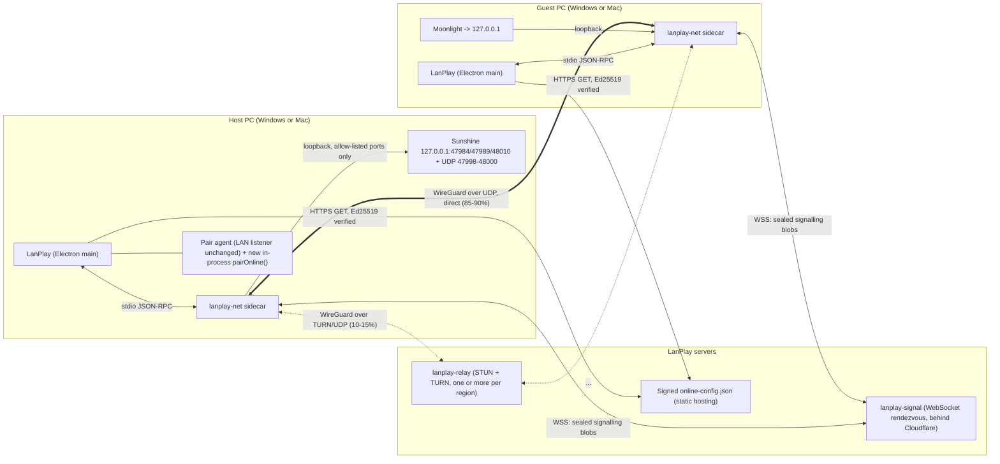

> **Superseded (2026-11-21).** This relay / WireGuard / signalling design was not built. LanPlay 0.5 online play is a typed
> host IP with code pairing and no LanPlay server: see `docs/RELEASE-0.5-PLAN.md` (decisions) and `docs/ONLINE.md` (user
> guide). From this document only the uplink budget (4B.1), the per-player bitrate rungs and the fact that Moonlight switches
> to "remote" mode by itself for a non-private address (1.2) are still used. The rest is kept as a record.

# LanPlay Online: design

Status: design only, nothing implemented. Written 2026-11-17 against LanPlay 0.4.1 (commit 8bc682b), Sunshine
v2026.914.233613 and moonlight-qt v6.2.0. No source file was changed to produce this document.

Legend used throughout: **[V]** = verified in this session (source read, command run, or vendor page fetched; the
source is listed in section 10). **[M]** = from memory or from third-party pages that disagreed with each other;
treat as unverified until re-checked. Anything that depends on an [M] fact is called out.

---

## 0. Summary of the recommendation

LAN play stays exactly as it is. Online play is added as a separate, opt-in transport:

1. A small LanPlay-owned sidecar process (`lanplay-net`, Go, GPL-3.0) runs next to the Electron app on both
   machines. It builds an encrypted peer-to-peer tunnel using **WireGuard in userspace** (wireguard-go plus the gVisor
   netstack: no driver, no admin rights, no virtual network adapter) over a path found by **ICE** (STUN hole punching,
   IPv6 first, optional router port mapping), with **TURN relays that LanPlay runs** as the fallback.
2. The tunnel is not a VPN. It forwards exactly six Sunshine ports and nothing else. On the guest it appears as
   `127.0.0.1:<the normal Sunshine ports>`; on the host the traffic arrives at Sunshine from loopback. Unmodified
   Sunshine and Moonlight both keep working, and the existing LAN-only checks in `ipnet.ts`, `agent.ts`,
   `discovery.ts` and `controller/server.ts` are **not relaxed at all**.
3. A small control plane (one Go binary to start with) does rendezvous and signalling only. It never sees keys,
   PINs or stream content. People connect with an invite code or link; there are no accounts in the first version.
4. Economics: roughly 85 to 90 percent of sessions should connect directly and cost nothing. The relayed remainder is
   capped (720p60 at about 8 Mbps) because relay bandwidth is the only cost that grows with players. With that cap,
   1,000 concurrent players costs on the order of 60 to 150 USD per month and 10,000 costs 500 to 3,000 USD per month
   on unmetered ports (about 7,000 USD if bought as metered traffic at 0.01 USD/GB). Relayed 4K for thousands of
   players is not affordable for a solo developer and this design does not offer it.

5. Sessions of up to about 100 people (section 4A) are split by role: up to 4 **players** get the direct,
   lowest-delay Moonlight path with input; everyone else is a **spectator** on one low-bitrate WebRTC stream, fed
   directly by the host while its upload lasts and by a LanPlay forwarding server after that. One home PC cannot
   upload to 100 people directly (500 Mbps at 5 Mbps each), and Sunshine needs one GPU encode per client, so "100
   direct" is not offered; "4 direct players plus an audience" is.

6. Small groups need no LanPlay server at all (section 4B): 2 to 4 players each get a direct tunnel and their own
   stream, sized by a measured uplink budget (four players at 1080p60 / 15 Mbps fit a 100 Mbps line). There is no
   way to send one stream to everyone: upload is always one copy per player, and encoding once would save GPU,
   not bandwidth. Without a relay, the estimated 8 to 30 percent of pairs behind hard NATs cannot connect; the relay
   and the forwarding server in items 1 and 5 are therefore optional later additions, not part of the first release.

7. The product model is couch co-op (section 4C): one shared screen, the host as P1 and up to three remote
   players as P2 to P4, each with an ordinary Moonlight session at the same quality. Sunshine already gives every
   client its own virtual pad, so the first release uses Moonlight's gamepad support with keyboard and mouse
   switched off; a LanPlay-owned pad channel with host-assigned, drop-proof slots follows. Controller games need a
   Windows host: a Mac host has no virtual pad yet and is watch-only.

The single biggest product-level caveat, independent of networking: a Moonlight guest has keyboard and mouse control
of the host's whole desktop. Online play must be invite-only until that is constrained (section 3.2).

---

## 1. Core problem framing

### 1.1 What has to cross the internet

Sunshine's ports, all derived from the base port 47989 [V: `src/contracts.ts` `SUNSHINE`, which cites Sunshine's
configuration docs; offsets also match Sunshine's `map_port`]:

| Port | Proto | Purpose | Forward online? |
|---|---|---|---|
| 47984 | TCP | HTTPS (pairing, launch, client-cert authenticated) | yes |
| 47989 | TCP | HTTP (`/serverinfo`, pairing start) | yes |
| 48010 | TCP | RTSP session setup | yes |
| 47998 | UDP | video | yes |
| 47999 | UDP | control (ENet: input, rumble, stats) | yes |
| 48000 | UDP | audio | yes |
| 47990 | TCP | Sunshine web UI / admin API | **never** |
| 47920 | TCP+UDP | LanPlay pair agent (plain HTTP) | **never** |
| 47921 | TCP | LanPlay phone-controller page | **never** (see 2.6) |

Bandwidth: Moonlight's own defaults are 10 Mbps for 720p60, 20 Mbps for 1080p60, 40 Mbps for 1440p60 and 80 Mbps
for 4K60 [V: moonlight-qt `getDefaultBitrate`]. LanPlay's current floor is 20 Mbps
(`BITRATE_LIMITS_MBPS.min` in `contracts.ts`), which is a LAN number and must be lowered for online. The configured
bitrate already includes Sunshine's forward error correction (default 20 percent [V]); audio and control add well
under 1 Mbps.

Latency budget: on a LAN the network adds 1 to 3 ms. Between two homes in the same country the path itself is
typically 15 to 60 ms round trip [M], so the transport we add must cost low single-digit milliseconds, must never
retransmit or queue video (a late frame is worthless), and must not add head-of-line blocking. That rules out
carrying video over TCP, over a TLS/WebSocket relay, or over anything with its own congestion control.

### 1.2 Two facts in the existing binaries that shape the design

- **Moonlight treats a loopback host as a remote host.** `isPrivateNetworkAddress` in moonlight-common-c matches
  10/8, 172.16/12, 192.168/16, 169.254/16 and the IPv6 local ranges, but not 127/8 [V]. In auto mode a non-private
  address selects remote streaming and caps the video packet size at 1024 bytes for IPv4 [V; the bundled 6.2.0 binary
  contains the string "Packet size capped at 1024 bytes for remote IPv4 streaming"]. So when Moonlight is pointed at
  `127.0.0.1` it automatically produces packets that fit inside a tunnel with room to spare. No flag is needed.
- **Sunshine treats a loopback client as "PC", which is handled like LAN.** `network.cpp` classifies 127.0.0.0/8 as
  PC, and `encryption_mode_for_address` gives PC and LAN the `lan_encryption_mode`, default 0 (off) [V, read at the
  pinned tag v2026.914.233613]. So Sunshine will not double-encrypt a stream that the tunnel already
  encrypts, and its "WAN" code paths are never involved.

Also relevant: Moonlight takes only the port from the RTSP session URL and keeps using the address it was given
[V], and it learns the HTTPS port from `/serverinfo`. Therefore the guest-side listener must use the **same port
numbers** as Sunshine, on `127.0.0.1`.

### 1.3 Options compared

| Option | What it is | Verdict |
|---|---|---|
| (a) Bare UDP hole punching per Sunshine port | STUN, then punch each of 3 UDP flows; TCP ports still unreachable | Not enough alone. Three TCP ports cannot be punched reliably, each flow needs its own mapping, nothing is encrypted or authenticated. Hole punching is kept, but as the path finder underneath (b). |
| (b) LanPlay-owned userspace tunnel | One punched UDP flow carries an encrypted tunnel that multiplexes all six ports and presents them on loopback | **Recommended.** One NAT mapping, one crypto layer, unmodified Sunshine/Moonlight, per-port allow-list, no admin rights. |
| (c) Relay everything (TURN/own relay) | All video through servers | Works for everyone, costs about 4 GB per player-hour at 9 Mbps. Only viable as the fallback for the minority that cannot go direct. |
| (d1) Tailscale client + headscale + DERP | Embed `tsnet`, self-host the coordinator | Fastest to a demo, but: headscale targets a single small tailnet, not tens of thousands of strangers with per-room ACL churn [M]; DERP relays run over TCP/TLS (Tailscale's own measurements show an example of 2.2 Mbit/s via DERP against 27.5 Mbit/s via a UDP peer relay [V, third-party summary of a Tailscale post]), which is unusable for video; and the owner would depend on Tailscale's client protocol. Rejected as the product, acceptable as a throwaway spike tool. |
| (d2) ZeroTier | Layer-2 mesh | Licence is source-available with commercial-use restrictions on parts of it [V]. Needs a virtual adapter and admin rights. Rejected. |
| (d3) NetBird | WireGuard mesh with its own control plane | Kernel/TUN oriented, admin rights, whole-machine exposure; management/relay are AGPL [M]. Rejected for the same exposure and privilege reasons. |
| (d4) libp2p / iroh | P2P stacks with hole punching and relays | Measured libp2p hole-punch success is about 70 percent [V], lower than a purpose-built ICE setup; their relays are stream-oriented. More stack than needed and still needs the port-forwarding layer on top. Rejected. |
| (d5) WebRTC data channels for video | SCTP over DTLS | SCTP congestion control and message framing fight a fixed-bitrate video stream. Rejected for the stream; **kept for the phone gamepad** (section 2.6), where it is the right tool. |
| (e) Patch Sunshine/Moonlight | Add ICE/relay support inside the GameStream protocol | Would mean maintaining forks of two large C++ projects and rebuilding/signing them on three platforms. Rejected for transport. One narrow exception worth revisiting later: per-client input permissions on the host (section 3.2). |

Any real mesh VPN (d1 to d3) has a second, decisive problem for this product: it joins a stranger's machine to a
network on which the host PC's file shares, RDP and every other listening service are reachable. Option (b) only ever
forwards six fixed ports to `127.0.0.1`.

### 1.4 The recommended data path in one paragraph

`lanplay-net` holds one UDP socket. ICE (pion/ice) finds the best working path between the two sidecars: IPv6
direct, IPv4 hole-punched, router-mapped, or relayed through a LanPlay TURN server. Over that path the two sidecars
run a WireGuard session (wireguard-go with a custom `conn.Bind` that sends through the ICE-selected path, the same
structure Tailscale's magicsock uses). Each side terminates the tunnel in a gVisor userspace network stack, not in
the OS. The guest sidecar listens on real `127.0.0.1` sockets with Sunshine's port numbers and pipes each connection
or datagram flow through the tunnel; the host sidecar accepts them on the virtual stack and connects out to the real
Sunshine on `127.0.0.1`. WireGuard has no congestion control, never retransmits, never answers unauthenticated
packets, and rekeys every two minutes. Video stays UDP end to end.

Packet size check: 1024-byte video payload + about 16 bytes of RTP/NV header + 28 inner IP/UDP + 32 WireGuard + 4
TURN ChannelData (relayed case only) + 48 outer IPv6/UDP = about 1,152 bytes, below the 1,280-byte IPv6 minimum MTU.
No fragmentation on any sane path.

### 1.5 How many sessions still need a relay

There is no published number for Indian consumer ISPs, and this is the largest unknown in the cost model.

- Tailscale reports direct NAT traversal "well north of 90%" in typical conditions [V], with an engineered
  traversal stack similar to the one proposed here.
- The largest public measurement of decentralised hole punching (libp2p DCUtR, 4.4 million attempts, 85,000
  networks, 167 countries) found about 70 percent, plus or minus 7 [V]. That stack does less than ICE (no port
  mapping, no IPv6 preference) and its population skews to hobbyist nodes.
- India specifics: mobile and much fixed broadband IPv4 is behind carrier-grade NAT [M], which is the hard case when
  both ends are symmetric. Against that, India has one of the highest IPv6 deployment rates in the world (72 to 78
  percent depending on the measurement [V, sources disagree on the exact figure]). Two peers that both have IPv6 do
  not need NAT traversal at all, only a simultaneous open through their routers' stateful firewalls, which succeeds
  far more often than IPv4 punching.

The failure case is narrow: direct fails only when **both** sides are hard (symmetric mapping, no IPv6, no working
port mapping) or one side blocks UDP entirely. Planning numbers used in the rest of this document:

| Scenario | Relayed share of sessions (r) |
|---|---|
| Good (IPv6 preferred, host port mapping works) | 8% |
| **Planning value** | **15%** |
| Bad (CGNAT on both ends is common among our users) | 30% |

Phase 0 spike C replaces these guesses with a measured number before any relay money is spent.

---

## 2. Architecture

### 2.1 Components



| Component | Runs where | Language | Responsibility |
|---|---|---|---|
| `lanplay-net` | host and guest, child process of Electron main | Go | Device keys, invite KDF, signalling client, ICE, port mapping, WireGuard, userspace port forwarding, path quality measurement. Talks to Electron over stdio JSON-RPC only; opens no local control socket. |
| Electron main (`src/core/online/*`) | host and guest | TypeScript | Spawns and supervises the sidecar, UI state, approval prompts, hands online pairing requests to the existing pair agent, launches Moonlight at `127.0.0.1`. |
| `lanplay-signal` | LanPlay servers | Go | Rooms, rendezvous, message relay between room members, issuing short-lived TURN credentials, rate limits, bans. Sees device public keys, room ids and IP addresses. Never sees invite secrets, WireGuard keys, PINs or stream data. |
| `lanplay-relay` | LanPlay servers, per region | Go on pion/turn (coturn is the drop-in alternative) | STUN binding responses and authenticated TURN/UDP allocations with per-allocation bitrate and time quotas. Forwards ciphertext only. |
| `online-config.json` | static host (GitHub Pages or Cloudflare Pages) | JSON, Ed25519-signed | Lists signalling endpoints/shards, relay regions, minimum client version, relay bitrate cap, kill switch. Same verification approach as the existing update manifest, with a **separate** signing key. |

Why a sidecar and not Node: there is no production-grade WireGuard, userspace TCP/IP stack or ICE agent for Node.
The Go combination proposed here (wireguard-go + gVisor netstack + a custom Bind) is the configuration Tailscale
ships in its userspace mode, so its throughput at tens of Mbps is not in question; the latency it adds on these
exact machines is measured in Phase 0. The sidecar is built from source in this repository by CI, pinned by SHA-256
in `vendor/manifest.json` like the other binaries, and ships inside the signed update.

### 2.2 Identity: anonymous device keys first

At first online use the sidecar generates and stores (through the existing `SecretStore`: DPAPI on Windows, the
keychain path on macOS):

- an X25519 static key: the device's WireGuard identity;
- an Ed25519 key: signs requests to the control plane. `deviceId` = first 16 bytes of SHA-256 of the Ed25519 public
  key, shown in the UI as a short fingerprint.

No email, no password, no account. Accounts (needed for a friends list that survives reinstall and spans devices)
are deferred to Phase 3 and layered on top: an account is then just a server-side set of device keys.

### 2.3 Invites and joining without anything secret touching the server

An invite is one string, for example `K7PQ-3M9X-TZ4W`: 12 Crockford base32 characters, 60 random bits. The link
form is `https://<online-domain>/j#K7PQ-3M9X-TZ4W`; the code sits in the URL fragment, which browsers do not send to
the server. The landing page offers "Open LanPlay" (custom `lanplay://join/…` protocol) and download buttons.

Both sides derive, inside the sidecar:

```
okm     = Argon2id(password = code, salt = "lanplay-invite-v1", memory = 64 MiB, iterations = 3, 64 bytes)
roomId  = okm[0..16)      sent to the server to find the room
roomKey = okm[16..48)     never leaves the two devices
```

A hostile or compromised signalling server knows `roomId` and could try to brute-force the code offline; at 2^60
candidates times a 64 MiB memory-hard hash that is not feasible. This gives typed codes the protection a PAKE would,
without adding a PAKE library. Rooms expire when the host closes them or after 24 hours, and five failed join
proofs burn the code.

Join sequence:

```mermaid
sequenceDiagram
  participant G as Guest sidecar
  participant S as lanplay-signal
  participant H as Host sidecar
  participant U as Host user
  H->>S: open room (roomId, signed by host device key, proof-of-work)
  G->>S: join(roomId), signed by guest device key
  G->>S: sealed{guestWgPub, deviceId, name, nonce, ts} under roomKey
  S->>H: forward sealed blob (opaque to S)
  H->>U: "Riya-PC (4F2A-9C1D) wants to join" Allow / Deny
  U-->>H: Allow
  H->>S: TURN credential request for this room+guest
  S-->>H: short-lived TURN credentials (both sides get their own)
  H->>S: sealed{hostWgPub, ICE ufrag/pwd, candidates, virtual IPs}
  S->>G: forward
  G->>S: sealed{ICE ufrag/pwd, candidates}  (trickled)
  S->>H: forward
  G-->H: ICE connectivity checks (direct first, relay after 4 s without a direct pair)
  G-->H: WireGuard handshake: both static keys + preshared key HKDF(roomKey,"wg-psk")
  Note over G,H: tunnel up; signalling server is no longer in the path
```

"Sealed" is XChaCha20-Poly1305 with a key derived from `roomKey`, a random 24-byte nonce and a timestamp; the host
keeps seen nonces for the life of the room, so a replayed join is dropped. Because the WireGuard handshake requires
both static keys and the preshared key, a signalling server that swaps keys cannot complete a handshake: there is no
MITM position for the server. ICE candidates (which contain IP addresses) travel inside sealed messages too.

After a successful first join the host records the guest's device key in a new "online devices" ledger (same
`KeyValueStore` pattern as `agent.pairedDevices`). From Phase 2 a remembered device may rejoin without a new code
when the host has "Friends can rejoin" switched on; those messages are sealed with a static-static X25519 box
instead of a room key, and the host still sees a notification and can revoke.

### 2.4 The data plane in detail

Virtual addressing: each tunnel is its own point-to-point network. The host is `100.127.0.1` and the guest is
`100.127.0.N` inside the two userspace stacks; these addresses never exist on either operating system, so they cannot
collide with a real LAN, with Tailscale, or with Sunshine's LAN ranges.

Guest side: listeners on `127.0.0.1` TCP 47984, 47989, 48010 and UDP 47998, 47999, 48000. Each accepted TCP
connection is dialled through the netstack to `100.127.0.1:<same port>`. Each UDP source port is a flow, forwarded
with the same source port, with an idle timeout of 60 s.

Host side: the netstack accepts only those six ports from an authenticated WireGuard peer and connects each to the
real `127.0.0.1:<same port>`. Everything else is dropped in the netstack; there is no IP forwarding, no route to the
host's LAN and no guest-to-guest path.

On a Windows host, the sidecar binds its outgoing loopback connections for guest N to source address `127.77.0.N`
(any 127/8 address is usable on Windows without configuration [M]). Sunshine and the pair agent then see a distinct
address per guest, which is what `LanPairAgent.doPair` matches on. macOS only has `127.0.0.1` by default, so on a
Mac host online pairings are serialised (one at a time, under the existing `pairMutex`); whether two already-paired
online guests can stream concurrently from the same loopback address on a Mac host is a Phase 0 question.

Path selection, in ICE priority order:

1. IPv6 host candidates (both ends global IPv6): simultaneous open through the routers' firewalls.
2. IPv4 server-reflexive candidates from STUN on the LanPlay relays: classic hole punch.
3. A router-mapped candidate: while a room is open the host sidecar asks its router for one UDP mapping through
   PCP, NAT-PMP, then UPnP IGD. With a mapping on the host, even a guest behind a symmetric NAT connects directly.
   Sunshine's own `upnp` setting stays `disabled`; only the single tunnel port is mapped, and it stays silent to
   anything that is not a valid ICE check or WireGuard handshake.
4. TURN relay candidates, requested only after 4 seconds without a working direct pair, from the region that
   minimises `rtt(host, relay) + rtt(guest, relay)` (both sides measure STUN round-trip to each region at start).

The sidecar reports the selected path type and a rolling RTT/loss estimate to Electron before Moonlight starts, so
the stream is launched with the right bitrate cap (section 4.4).

### 2.5 Pairing online: the PIN never crosses the internet in the clear

The existing no-typing pairing flow is reused, with the transport swapped:

1. Guest: `Moonlight pair 127.0.0.1 --pin <random>` (unchanged `buildPairArgs`; `assertHostArg` already accepts the
   loopback literal). Moonlight's pairing request reaches Sunshine through the tunnel.
2. Guest: instead of `agentRequest()` doing plain HTTP to `<ip>:47920`, `ClientPairingService` sends
   `{pin, clientName, clientId}` as a JSON-RPC call to its sidecar, which carries it over a tunnel-internal control
   stream (a TCP connection inside WireGuard to a service port that exists only in the host's netstack).
3. Host: the sidecar hands the request, together with the authenticated peer's device key and the loopback source
   address it uses for that peer, to Electron main over stdio. Main calls a new method on the pair agent,
   `pairOnline(peer, request)`, which reuses `doPair()` with `remote` = that loopback address.
4. Policy for `pairOnline`: the LAN `autoApprove` setting is ignored. The pairing is accepted only if this device
   key was approved for the current room (step "Allow" in 2.3) or is a remembered device with rejoin enabled.

So the PIN is only ever inside the WireGuard tunnel, the LAN listener on 47920 keeps its "private source only"
guard untouched, and port 47920 is not on the tunnel's allow-list (it must not be: that listener trusts loopback
sources and honours auto-approve).

### 2.6 Phone gamepad for a remote friend

Today the phone talks to the host over the LAN: HTTP page plus WebSocket on 47921, guarded by private source
address, IP-literal Host header and the `?t=` token. A remote friend's phone is on the friend's Wi-Fi, not the
host's. Three ways to bridge that:

| Option | Latency | Cost | Complexity | Verdict |
|---|---|---|---|---|
| A. Guest's own LanPlay app serves the page on the guest's LAN and forwards frames through the existing tunnel | phone-to-PC Wi-Fi (2 to 5 ms) + tunnel path; no extra hop | none | low: reuse `ControllerServer` as is, add a forwarding backend | **Phase 2.** Covers the common case: the friend is streaming on a PC or Mac and wants a phone as the pad. |
| B. Hosted HTTPS page + WebRTC data channel straight to the host sidecar | one P2P hop; unordered, `maxRetransmits: 0` behaves like UDP | signalling only; when relayed, about 15 kbit/s per phone, effectively free | medium: pion/webrtc in the sidecar, hosted page, token redesign | **Phase 4.** For a friend who has only a phone (for example watching on a TV through another device). Works in iOS Safari [M]. |
| C. Hosted page + WebSocket through a LanPlay server | two TCP hops, head-of-line blocking on loss: spikes of 100 ms+ on bad Wi-Fi | negligible bandwidth, but every phone holds a server connection | low | Last-resort fallback for B on networks that block UDP. Never the default. |

Option A in detail: the guest app starts the same `ControllerServer` (same guards: private address, IP Host header,
its own locally generated token that never leaves the guest's home). Its manager is a `RemoteControllerBackend`
that sends the already-sanitised frames (`parseClientMessage` output) over the tunnel control stream. On the host,
main calls `ControllerManager.join(connId, name, "online:<deviceId>:<n>")`. The host re-validates every frame with
the same parser (never trust the guest's sanitising), enforces the four-pad limit and the silence timeouts as today,
and exposes one switch: "Allow controllers from online guests". Layouts for remote phones are stored on the guest's
PC, since `layout-store.ts` keys them by the phone's LAN IP.

The existing LAN page stays plain HTTP by design (an HTTPS page cannot open `ws://` to a LAN IP), and is untouched.

### 2.7 What is unchanged

mDNS, the UDP broadcast probe, the 47989 subnet probe, manual add-by-IP with its private-address refusal, the LAN
pair agent and all six of its guards, the LAN phone page, auto-update. A host found on the LAN is always used over
the LAN: hosts are merged by Sunshine `uniqueid` as today, and a LAN address wins over the online entry.

---

## 3. Security and abuse

### 3.1 Threat model

| Asset | Adversary | Attack | Mitigation |
|---|---|---|---|
| Host PC | Internet scanner | Find and probe an online host | The host opens no inbound port. Its only UDP socket ignores anything that is not a valid ICE check (HMAC with a per-session password) or WireGuard handshake (silent by design). Nothing identifies it as LanPlay. |
| Host PC | Someone with a leaked invite | Join without being wanted | Join requires the code **and** an explicit Allow on the host showing device name and fingerprint. Codes expire, are burned after 5 bad proofs, and "New code" revokes the old one. |
| Host PC | Approved guest | Reach other services on the host or its LAN | Port allow-list of six Sunshine ports to `127.0.0.1`, enforced in the host's userspace stack. No 47990, no 47920, no LAN routing. |
| Host PC | Approved guest | Use the desktop: Moonlight sends keyboard and mouse | See 3.2. This is the real residual risk. |
| Stream content, PIN | Signalling server, relay operator, network observer | Read or alter | End-to-end WireGuard (ChaCha20-Poly1305, Curve25519); relays and the signalling server see ciphertext only. The server cannot MITM because it never has `roomKey` (2.3). |
| Session | Network attacker | Replay captured packets or join blobs | WireGuard's counter window; nonce and timestamp cache on sealed signalling messages. |
| Long-lived secrets | Device theft, key leak | Reuse | WireGuard rekeys every 2 minutes with forward secrecy. Device keys can be reset ("Reset online identity"), which invalidates every remembered pairing for that device. The host can revoke any device from the ledger; that also unpairs it in Sunshine through the existing `revoke()`. TURN credentials live for hours, room codes for at most a day. |
| Guest PC | Malicious host | Attack the guest through the tunnel | The guest stack accepts no inbound connections at all; it only dials out. Moonlight pins the host certificate as today. |
| Local machine | Another local process | Talk to the sidecar | No local control socket: the sidecar is driven only over the stdio pipes of its parent. The loopback Sunshine-port listeners on the guest are equivalent to today's exposure of Sunshine to local processes on a host. |

### 3.2 The exposure that networking cannot fix

A paired Moonlight client can type and click on the host's desktop. On a home LAN that is the point. For a remote
person it is equivalent to handing over the PC. Consequences for the design:

- Online play is **invite-only**. No public lobby, no matchmaking, no "join random host", until there is a way to
  restrict a guest to gamepad input.
- The host UI says so in plain words the first time a room is opened: "People you invite can control this PC as if
  they were sitting at it. Only invite people you trust."
- Phase 2 adds "Guests: gamepad only", implemented with Sunshine's global `keyboard`/`mouse` input switches while a
  room is open [M: these config keys exist upstream; whether they apply without a restart is unverified]. Per-client
  permissions do not exist in upstream Sunshine as far as I know [M]; the Apollo fork has them. If public lobbies
  ever become a goal, this is the one place where patching or swapping the host server (option (e)) is justified.

### 3.3 Abuse of the service

| Abuse | Control |
|---|---|
| Relay used as free bandwidth (open relay) | TURN allocations require credentials minted by `lanplay-signal` for a specific room and device pair after the host approved the guest (TURN REST scheme: time-limited username, HMAC password). Each allocation is permitted exactly one peer address, is policed to the relay bitrate cap by a token bucket, and has a session time limit and a per-device daily budget. A relay will not forward to arbitrary destinations. |
| Relay as a DDoS reflector | STUN binding responses are about the size of the request. Unauthenticated TURN requests get at most a few 401 responses per second per source address, then silence. No RFC 5780 "change address" behaviour. |
| DDoS on the control plane | `lanplay-signal` sits behind Cloudflare's proxy (WebSockets are supported on the free plan [M]); the origin address is not published. Established sessions do not depend on it, so an outage blocks new joins only. |
| DDoS on relays | Relay addresses are given only to authenticated clients, relays are stateless and replaceable, and the cheap hosts proposed include volumetric DDoS filtering [M]. A relay under attack is dropped from `online-config.json`; affected sessions re-run ICE. |
| Room and signalling spam | Requests are signed by a device key; opening a room costs a small proof of work (about half a second of CPU) and is rate limited per key and per IP; five bad join proofs burn a room; device keys and IP ranges can be banned. |
| Sybil device keys | Keys are free to create, so bans are a speed bump, not a wall. That is acceptable while everything is invite-only. Accounts in Phase 3 add a costlier identity. |
| Harassment, illegal content | Streams are end-to-end encrypted, so content moderation by the operator is impossible; this is the second reason to stay invite-only. Provide a report address, and the ability to ban a device key and refuse relay service. |

### 3.4 Privacy

- A direct connection reveals each peer's public IP address to the other, as in any peer-to-peer game. The join and
  invite screens say so once. A "Hide my IP (always use a relay)" switch is available; it consumes relay budget.
- The signalling server necessarily sees source IPs, device public keys and room ids. Policy: no accounts, no stream
  metadata beyond start/stop and path type, connection logs kept 7 days for abuse handling, aggregate metrics only.
- The app's README currently says "no cloud, no accounts, no telemetry". That stays true for LAN play and must be
  reworded honestly for online play.
- Diagnostics: `redact.ts` gains rules for invite codes, peer public addresses and TURN credentials.

### 3.5 Existing LAN weaknesses that are deliberately not carried over

| LAN behaviour today | Why it is acceptable on a LAN | Online equivalent |
|---|---|---|
| PIN sent over plain HTTP to port 47920 | Private source addresses only | PIN travels only inside the WireGuard tunnel; 47920 is never forwarded |
| `autoApprove` ON by default | Anyone on your Wi-Fi is presumed trusted | Ignored for online; every new device needs an explicit Allow |
| Trust by source IP (`isPrivateAddress`) | Routers do not route RFC 1918 from outside | Trust by device key authenticated in the WireGuard handshake; no IP-based trust at all |
| First link enrolment can be MITM'd by a LAN attacker (`link-contract.ts`) | Documented limitation | First contact is authenticated by the invite secret |
| Phone page token in a `?t=` query string over HTTP | Never leaves the home network | Still never leaves a home network (option A); the hosted page in Phase 4 uses a one-time join secret in the URL fragment and an HTTPS origin |

---

## 4. Scale model

### 4.1 Definitions and formulas

- `N` = peak concurrent players (hosts plus guests in online sessions).
- Average session = 2.2 players, so video streams `S = 0.55 x N`.
- `r` = share of streams that are relayed (8%, **15%**, 30%; section 1.5).
- `b` = wire rate of a relayed stream. With the relay cap at 8 Mbps video: plus audio/control and about 7 percent
  tunnel overhead, `b = 9 Mbps`.
- Peak relay throughput: `P = N x 0.55 x r x b`.
- Monthly volume: evenings dominate, so average load is taken as 30 percent of peak. 1 Mbps sustained for a month
  is 0.3285 TB, so `TB per month = P x 0.30 x 0.3285 = P x 0.0986`.
- One relayed player-hour is `9 Mbps x 3600 s / 8 = 4.05 GB`.
- A 1 Gbit/s port run at 60 percent carries about 66 relayed streams (each stream uses 9 Mbps in and 9 Mbps out).

### 4.2 Relay load

| N (peak concurrent) | Streams | r | Relayed streams | Peak relay throughput | Volume per month | 1 Gbit/s ports at 60% |
|---|---|---|---|---|---|---|
| 1,000 | 550 | 8% | 44 | 0.40 Gbit/s | 39 TB | 1 |
| 1,000 | 550 | **15%** | 83 | 0.74 Gbit/s | 73 TB | 2 |
| 1,000 | 550 | 30% | 165 | 1.49 Gbit/s | 146 TB | 3 |
| 10,000 | 5,500 | 8% | 440 | 3.96 Gbit/s | 390 TB | 7 |
| 10,000 | 5,500 | **15%** | 825 | 7.43 Gbit/s | 732 TB | 13 |
| 10,000 | 5,500 | 30% | 1,650 | 14.9 Gbit/s | 1,464 TB | 25 |
| 100,000 | 55,000 | 8% | 4,400 | 39.6 Gbit/s | 3,905 TB | 66 (or 7 x 10G) |
| 100,000 | 55,000 | **15%** | 8,250 | 74.3 Gbit/s | 7,320 TB | 125 (or 13 x 10G) |
| 100,000 | 55,000 | 30% | 16,500 | 148.5 Gbit/s | 14,640 TB | 250 (or 25 x 10G) |

For contrast, the same table without a relay cap (1080p60 at 20 Mbps, `b = 22`) is 2.4 times larger in every cell,
and relayed 4K60 at 80 Mbps is nearly 10 times larger: 100,000 players at 15 percent would need about 730 Gbit/s of
relay capacity. That is the "economically impossible" case, and the reason the cap exists.

### 4.3 What a terabyte costs

| Source | Price | Status |
|---|---|---|
| Hetzner dedicated server, 1 Gbit/s uplink (Germany/Finland only) | unlimited traffic, flat server price | [V] terms; server price roughly 40 to 60 EUR/month [M] |
| Hetzner, 10 Gbit/s uplink | 20 TB included, then 1 EUR/TB | [V] |
| Hetzner Cloud, EU | 20 TB included per server, about 1 EUR/TB after | [V] incoming free; overage figure from third parties [M] |
| Hetzner Cloud, Singapore | about 7.40 EUR/TB overage, small included allowance | [M], third-party pages |
| Contabo VPS, Navi Mumbai | "unlimited traffic" on a 300 Mbit/s port, 10.35 EUR/month for the listed tier | [V] on Contabo's own page; a third party describes a 32 TB fair-use ceiling [M] |
| OVHcloud VPS, Mumbai | monthly quota of 0.5 to 3 TB, then throttled to 10 Mbps | [V] on OVH's page: unusable for relays |
| Vultr (has Indian regions) | 0.01 USD/GB = 10 USD/TB overage, pooled allowance | [V] rate from Vultr docs; India-specific rate not confirmed |
| DigitalOcean, Akamai/Linode in India | about 0.01 USD/GB | [M] |
| Oracle Cloud | 10 TB/month free egress, then about 0.0085 USD/GB (US rate) | [M], sources conflict; APAC rate not found |
| Cloudflare Realtime TURN | 0.05 USD/GB = 50 USD/TB, first 1,000 GB/month free | [V] |
| AWS/GCP/Azure egress | roughly 0.09 USD/GB = 90 USD/TB and more from India | [M] |

Two honest observations. First, the cheapest bandwidth in the world (Hetzner's flat 1 Gbit/s) is in Europe, and the
players are mainly in India. A relay must be near the players: a Delhi-to-Bangalore session bounced through
Singapore or Frankfurt adds tens to hundreds of milliseconds. So Indian relay capacity has to be bought in India,
where the options are (a) "unmetered" VPS ports with fair-use ambiguity, (b) metered cloud at about 10 USD/TB, or
(c) unmetered dedicated servers from Indian hosts, for which no verified price was found in this session and quotes
are needed. Second, the big clouds and Cloudflare are 5 to 90 times more expensive per terabyte than those options
and are useful only as overflow or as a 1,000 GB/month free failover.

### 4.4 Monthly cost by tier (planning case, r = 15%, 9 Mbps relay cap)

| | 1,000 concurrent | 10,000 concurrent | 100,000 concurrent |
|---|---|---|---|
| Relay volume | 73 TB | 732 TB | 7,320 TB |
| Relays on unmetered ports | 5 x 300 Mbit/s VPS in Mumbai (about 52 EUR) + 1 EU and 1 US/SG node (about 15 EUR) | about 13 x 1 Gbit/s unmetered servers, mostly India: 450 to 3,000 USD depending on Indian dedicated pricing [M] | about 13 x 10 Gbit/s unmetered servers plus regional spread: 10,000 to 25,000 USD [M] |
| Same volume bought metered at 10 USD/TB | about 730 USD | about 7,300 USD | about 73,000 USD |
| Same volume on Cloudflare TURN | about 3,600 USD | about 36,500 USD | about 366,000 USD |
| Control plane | 1 small VPS: 5 to 10 USD | 2 VPS + managed or self-run Postgres: 30 to 60 USD | 4 to 6 nodes + Postgres + message bus: 200 to 400 USD |
| **Realistic total** | **60 to 150 USD** | **500 to 3,000 USD** (7,000+ if metered) | **10,000 to 25,000 USD**; 3,000 to 15,000 with the levers in 4.5 |
| Per peak-concurrent player | 0.06 to 0.15 USD | 0.05 to 0.30 USD | 0.03 to 0.25 USD |

Reading the last column plainly: 100,000 concurrent players is on the order of one to two million monthly users.
At that size relay cost is a five-figure monthly bill even with every lever pulled, which is about one US cent per
monthly user. It is affordable only with some revenue (a supporter tier, section 4.5), and it should not be funded
out of pocket. Up to roughly 10,000 concurrent, a solo developer can carry it.

Sensitivity: every cost above scales linearly in `r` and in `b`. If Phase 0 measures r = 30 percent, double the
relay line; if the relay cap is lowered to 5 Mbps (720p60 HEVC at modest quality), multiply by 0.6.

### 4.5 Keeping relay load low, in order of payoff

1. **Prefer IPv6 and add host port mapping** (PCP/NAT-PMP/UPnP). These attack `r` directly and cost nothing.
2. **Cap relayed streams** at 720p60 / 8 Mbps and tell the user why. Direct sessions keep full quality.
3. **Lazy relay allocation**: only ask for TURN after 4 s without a direct path, and re-try direct on network change.
4. **Session and daily relay budgets** for free use (for example 2 hours per session, 4 hours per device per day),
   with a supporter tier that lifts the time limit and raises the cap. This turns the one variable cost into the
   thing people pay for, and nothing about direct play is paywalled.
5. **Pick the relay by summed RTT**, so traffic lands on the nearest region and cheap European capacity serves
   European users.
6. **Community relays** (Phase 4): any user with a public IPv4/IPv6 address or a working port mapping can run the
   open-source `lanplay-relay` and donate capacity; content is end-to-end encrypted so a volunteer relay sees only
   ciphertext. Needs reputation and abuse handling, so it is not early work.
7. **Overflow, not baseline**: Cloudflare TURN's free 1,000 GB/month as a failover target when LanPlay relays are
   down or full. At 4.05 GB per relayed hour that is about 250 stream-hours a month, enough for outages only.

### 4.6 Control plane capacity

| | 1,000 | 10,000 | 100,000 |
|---|---|---|---|
| WebSocket connections (players in sessions x about 1.5 for idle apps with online enabled) | 1,500 | 15,000 | 150,000 |
| Heartbeats (one per 25 s per connection) | 60/s | 600/s | 6,000/s |
| Joins (45-minute average session, about 30 signalling messages per join) | 0.2 joins/s, 6 msg/s | 2 joins/s, 60 msg/s | 20 joins/s, 600 msg/s |
| STUN/keepalive packets on relays | about 100/s | about 1,000/s | about 10,000/s |
| Memory at about 20 kB per connection | 30 MB | 300 MB | 3 GB |
| Deployment | one process, one VPS; rooms in memory; SQLite for bans and counters | one process still suffices; add a warm standby and move durable data to Postgres | 4 to 6 shards + Postgres + a message bus for cross-shard presence |

The control plane is not the scaling problem: signalling is a few messages per join and then silence.

State and sharding:

- Rooms are ephemeral and live in the memory of exactly one signalling node. Clients find that node by rendezvous
  hashing `roomId` over the shard list in the signed `online-config.json`, so both ends land on the same node with
  no shared state and no load balancer logic. A node restart drops its rooms; hosts re-open them automatically, and
  running sessions are unaffected.
- Durable data (ban lists, relay budgets, later accounts and friends) goes to SQLite at first, Postgres from
  Phase 3.
- Presence and friends (Phase 3) are the only cross-shard feature and are what introduces a message bus (NATS or
  Redis pub/sub).

Regions: Mumbai first (signalling can stay in one place globally; only relays and STUN need to be near players).
Add Singapore, Frankfurt and a US-East relay when usage appears there; adding a region is one entry in the signed
config plus one server.

---

## 4A. Sessions with up to 100 members

Added requirement: one session may hold about 100 people (one host plus players and viewers), with the lowest
possible delay, connecting directly wherever possible. This section takes that literally, shows where it stops being
physically possible, and gives the design that gets as close as a home internet line allows.

### 4A.1 One host PC streaming directly to N people: the upload math

Upload the host needs, before about 10 percent of audio, control and tunnel overhead:

| Viewers (N) | 5 Mbps each | 10 Mbps each | 20 Mbps each |
|---|---|---|---|
| 1 | 5 Mbps | 10 Mbps | 20 Mbps |
| 2 | 10 Mbps | 20 Mbps | 40 Mbps |
| 4 | 20 Mbps | 40 Mbps | 80 Mbps |
| 10 | 50 Mbps | 100 Mbps | 200 Mbps |
| 100 | 500 Mbps | 1,000 Mbps | 2,000 Mbps |

What Indian homes have: no current Ookla median for fixed upload could be verified in this session. The data
points found are an Ookla reading of about 42 Mbps average fixed upload (year unclear) [M], a 15.75 Mbps median
upload on 5G [M, press report of Ookla data], and about 26 to 32 Mbps for fixed-wireless home internet [M, an
Opensignal summary with garbled wording]. Entry fibre plans are commonly symmetric 30 to 100 Mbps [M]. A stream must
not use more than about 70 percent of the line or it starves the game's own traffic and everything else in the
house. So:

| Host line (upload) | Usable (70%) | What it can serve directly |
|---|---|---|
| 15 Mbps (5G, weak FWA) | 10 Mbps | 1 player at 10 Mbps, or 2 at 5 |
| 40 Mbps (entry fibre) | 28 Mbps | 2 players at 10 Mbps plus 3 spectators at 2.5 |
| 100 Mbps | 70 Mbps | 4 players at 10 Mbps plus 12 spectators at 2.5 |
| 300 Mbps | 210 Mbps | 4 players at 15 Mbps plus about 55 spectators at 2.5 |
| 1 Gbit/s | 700 Mbps | 100 people at 5 Mbps, in theory |

**One hundred direct viewers from one home PC is not possible on a normal Indian connection at any watchable
bitrate.** Even at 2.5 Mbps it needs 250 Mbps of sustained upload. A typical host can carry 2 to 4 players and a
handful of spectators directly; everyone beyond that has to be fed by something other than the host's uplink.

### 4A.2 What Sunshine and the GPU allow

- **Sunshine does serve several clients at once.** In the pinned v2026.914.233613 source the RTSP server keeps a set
  of session slots ("New streaming session started [active sessions: N]"), a second client joins the running app
  through `/resume`, display setup is skipped when a session already exists, and video/audio pings are matched per
  client by payload rather than by address [V: `rtsp.cpp`, `nvhttp.cpp`, `stream.cpp` at the tag]. The old `channels`
  limit no longer exists in the configuration [V]. There is one community report of a second client failing on
  Windows [M]; real behaviour goes into Phase 0.
- **Every client gets its own encoder session** at its own resolution and bitrate, fed from one shared capture
  thread [V: `video.cpp`]. There is no "encode once, send to many" in Sunshine, and the GameStream protocol is
  per-client (own encryption keys, own FEC, own keyframe requests), so its packets cannot simply be copied to more
  viewers.
- **Encoder limits.** NVIDIA's consumer drivers cap concurrent NVENC sessions per system: 8 according to the Video
  Codec SDK 13.0 application note, 12 according to the 13.1 note [V, the two documents disagree]. Each extra
  1080p60 encode also takes encoder time, VRAM and a scaling pass from the same GPU that is rendering the game; a
  few percent of GPU per stream is the usual experience [M], and it is measured in Phase 0. Intel Quick Sync and AMD
  AMF have no documented fixed cap [M]. Software encoding manages about one stream.
- **All Moonlight clients share one desktop and one keyboard and mouse**; gamepads are per client.

Conclusion: Sunshine is the right tool for a few players and the wrong tool for an audience. Practical ceiling:
**4 remote players** (4 encodes, leaving headroom under the 8-session cap for the spectator encode below).

### 4A.3 Roles

(Superseded by the couch co-op roles table in 4C.6; kept for the reasoning.)

| Role | How many | Path | Input | Target delay |
|---|---|---|---|---|
| Host | 1 | local | everything | none |
| Player | up to 4 | Moonlight through the tunnel of section 2; direct P2P, relay only as fallback | gamepad (and keyboard/mouse unless "gamepad only") | 35 to 70 ms direct |
| Spectator | up to about 96 | one separate low-bitrate spectator encode, delivered over WebRTC: direct from the host while its uplink budget lasts, then through a LanPlay forwarding server | none | 80 to 230 ms |

The host can promote a spectator to a free player seat and demote a player. Spectators never get a Sunshine
pairing, never reach a Sunshine port and cannot send input, so the trust problem of section 3.2 applies only to
the handful of players. Player invites and watch invites are different codes.

### 4A.4 Fan-out options for spectators

Per-hop figures: forwarding an already-encoded packet costs about 1 to 2 ms of processing; the cost of a hop is the
extra network leg, 10 to 30 ms one way between Indian cities [M], more for a viewer on Wi-Fi.

| Option | Added delay | Who pays the bandwidth | Problems | Verdict |
|---|---|---|---|---|
| A. More Sunshine sessions, direct | none | host: N x bitrate up; one GPU encode per viewer | Stops at 8 to 12 encodes and at the host's uplink; every viewer would have input | Players only |
| B. Host sends the spectator stream directly to each spectator (host is the fan-out point) | none beyond the direct path | host: N x 2.5 Mbps | Limited by uplink: 3 to 12 spectators for typical lines | **Use first, up to the measured uplink budget** |
| C. Forwarding server (SFU) in the nearest region | one extra leg: +5 to 25 ms when the server is in-country | LanPlay: 2.75 Mbps per spectator, 1.24 GB per spectator-hour; host uploads the stream once | Costs money for every spectator, not for 15 percent of them | **Use for everyone the host cannot feed** |
| D. Viewer-assisted tree (spectators re-forward to 2 or 3 others) | +15 to 35 ms per level; 96 spectators at fan-out 3 is 4 levels, so +45 to 105 ms for the leaves | spectators: 5.5 to 8 Mbps of their upload each; LanPlay: nothing | A parent who leaves freezes its whole subtree for 1 to 3 s; every edge needs its own NAT traversal (about 15 percent fail); needs upload many viewers lack; much more code | Later, as a cost reducer, depth 2 at most, only on viewers measured to have spare uplink and an open NAT |
| E. Lower-bitrate ladder from the host (720p30 at 2.5 Mbps default, 480p30 at 1 Mbps "data saver") | none | scales every option above | A second ladder rung is one more encode | **Yes: this is what makes B and C affordable** |
| F. WebRTC as the spectator transport | jitter buffer of 30 to 100 ms unless tuned down | none in itself | Not as tight as Moonlight | **Yes**: it is the transport for B, C and D; servers and browsers already speak it, and it lets someone watch from a phone or browser with no install |

Recommendation: **E + F + B, then C.** The host produces one spectator encode (720p30, 2.5 Mbps, H.264 so every
device decodes it in hardware). The sidecar sends it over WebRTC directly to as many spectators as the measured
uplink budget allows after the players are served, and sends one copy to a LanPlay forwarding server
(`lanplay-sfu`, built on pion like the relay, running on the same machines) which feeds the rest. The tree (D) is
kept as a Phase 4 optimisation and never as the default, because its delay and its freezes are worst exactly for
the large sessions it is meant to help.

How the spectator encode is made, in order of preference: (1) Chromium's own screen capture and hardware encoder
inside a hidden Electron window, published through WebRTC: no new native code, but whether it can capture every
full-screen game alongside Sunshine's capture is unverified; (2) a small native capture-and-encode helper;
(3) the sidecar joining Sunshine as a loopback GameStream client and repackaging that H.264 without re-encoding,
which avoids a second capture but means implementing the GameStream client protocol. Phase 0 spike F decides.

The rule "direct whenever NAT allows, relay only as fallback" is kept, with one addition for spectators: **direct
whenever NAT and the host's uplink allow.** Players always have first claim on the uplink.

### 4A.5 Latency budget

Typical figures for two cities in India; all [M] estimates to be replaced by Phase 0 measurements.

| Stage | Player, direct | Player, relayed | Spectator, direct from host | Spectator, via forwarding server | Spectator, tree leaf (3 extra levels) |
|---|---|---|---|---|---|
| Capture + encode | 4 to 10 ms | 4 to 10 | 15 to 40 (30 fps) | 15 to 40 | 15 to 40 |
| Network, one way | 10 to 30 | 15 to 55 | 10 to 30 | 15 to 55 | 55 to 135 |
| Forwarding | 0 | 1 | 0 | 1 to 2 | 3 to 6 |
| Receive buffer | 0 to 5 | 0 to 5 | 30 to 100 | 30 to 100 | 30 to 100 |
| Decode | 3 to 10 | 3 to 10 | 5 to 10 | 5 to 10 | 5 to 10 |
| Display (60 Hz) | 8 to 16 | 8 to 16 | 8 to 16 | 8 to 16 | 8 to 16 |
| **Total picture delay** | **25 to 70 ms** | **30 to 95 ms** | **70 to 195 ms** | **75 to 225 ms** | **115 to 305 ms** |

Players additionally feel their input travelling back (same network leg again). A spectator's delay does not affect
play, so 100 to 200 ms is invisible to them; a player's does, which is why the uplink and the direct paths are
reserved for players.

### 4A.6 Scale and cost with 100-member sessions

The change in economics: a relayed player costs servers 9 Mbps in 15 percent of cases; a spectator beyond the
host's direct budget costs 2.75 Mbps in 100 percent of cases. Assume the host feeds 10 percent of spectators itself.

- Server load per member: player `0.55 x 0.15 x 9 = 0.74 Mbps`; spectator `0.9 x 2.75 = 2.48 Mbps`.
- One full 100-member session (4 players, 96 spectators): about 240 Mbps of server egress, 107 GB per hour. That is
  1.07 USD per session-hour at 10 USD/TB, 0.11 at Hetzner's 1 EUR/TB, 5.35 on Cloudflare. It equals the server load
  of about 180 ordinary two-player sessions.
- A 1 Gbit/s port at 60 percent feeds about 218 spectators (egress only), a little over two full sessions.

| Peak concurrent members | Mix | Peak server egress | Volume per month | Metered at 10 USD/TB | On unmetered ports [M] |
|---|---|---|---|---|---|
| 1,000 | section 4 baseline, no spectators | 0.74 Gbit/s | 73 TB | 730 USD | 60 to 150 USD |
| 1,000 | 10% spectators | 0.92 Gbit/s | 90 TB | 900 USD | 80 to 200 USD |
| 1,000 | ten 100-member sessions | 2.4 Gbit/s | 238 TB | 2,400 USD | 250 to 1,000 USD |
| 10,000 | no spectators | 7.4 Gbit/s | 732 TB | 7,300 USD | 500 to 3,000 USD |
| 10,000 | 10% spectators | 9.2 Gbit/s | 903 TB | 9,000 USD | 600 to 3,500 USD |
| 10,000 | one hundred 100-member sessions | 24 Gbit/s | 2,383 TB | 23,800 USD | 2,000 to 8,000 USD |
| 100,000 | no spectators | 74 Gbit/s | 7,320 TB | 73,000 USD | 10,000 to 25,000 USD |
| 100,000 | 10% spectators | 92 Gbit/s | 9,030 TB | 90,000 USD | 12,000 to 30,000 USD |
| 100,000 | one thousand 100-member sessions | 242 Gbit/s | 23,830 TB | 238,000 USD | 30,000 to 80,000 USD |

So large sessions are affordable as an occasional thing and roughly triple the bill if they become the normal way
the product is used. Controls: spectator seats above the host's own direct budget draw on the same relay budget
and supporter tier as relayed play (section 4.5); the default spectator rung is 720p30 at 2.5 Mbps with a 1 Mbps
rung when the server pool is busy; a session's server-fed audience is capped by configuration (for example 20 free,
96 for supporters) until real costs are known; the Phase 4 tree moves load to viewers with spare uplink.

Control plane: a 100-member room is 100 WebSockets and one roster to broadcast; trivial next to section 4.6. The
forwarding server holds about 100 WebRTC peer connections per session, which is ordinary SFU work.

### 4A.7 The single biggest risk of this requirement

The host's home upload. It caps direct fan-out at a handful of people, so "100 people, all direct" cannot be
delivered; the audience has to be carried by servers that LanPlay pays for at 1.24 GB per spectator-hour, with no
85 percent "free because direct" discount. If large watch parties become popular the bandwidth bill grows about
three times faster per member than in the two-player model, and the host's line is at the same time carrying up to
four player streams, which is where stutter will show first.

---

## 4B. Small groups with no LanPlay server: 2 to 4 players on one host uplink

The owner's question: a typical host has about 100 Mbps of upload. Can 2 to 4 players share it well, without each
player costing a separate full stream ("one car goes for everyone"), and without a LanPlay relay or forwarding
server?

Short answer. Four players fit on a 100 Mbps line at 1080p60 and 15 Mbps each, with no LanPlay relay and no
always-on server. But there is no "one car": on the internet the host must send every player their own copy of the
packets, so upload is always N times the per-player bitrate. Encoding once would save GPU work, not bandwidth. The
real levers on upload are the per-seat bitrate and the number of seats, so the design below is a budget, not a
trick.

### 4B.1 Uplink budget

What a configured bitrate costs on the wire [V: Sunshine `rtsp.cpp` at the pinned tag]. When Moonlight sends its
configured bitrate, Sunshine shrinks the encoder's bitrate so that video plus forward error correction stays inside
it: the encoder gets `configured x (100 - fec_percentage) / 100`, minus audio (96 or 256 kbit/s per channel), minus
up to 500 kbit/s. With the default 20 percent FEC, a "15 Mbps" stream is about 11.3 Mbps of picture and about 15 Mbps
of video packets. On top come packet headers and the tunnel: roughly 92 bytes around each 1,024-byte payload, plus
audio and control. Planning factor: **wire rate = 1.12 x configured bitrate**.

How much of the line to use. Planning rule: **70 percent of the measured upload** (not of the advertised number).
The other 30 percent covers: encoder bursts on scene changes and keyframes (the rate is an average, not a ceiling);
the host game's own online traffic (small, but it must never queue); TCP acknowledgements for the household's
downloads (about 2 to 3 percent of the download rate [M]); other people in the house; and the fact that once a home
router's upload queue fills, every packet including game input waits behind it (bufferbloat) [M]. The 70 percent
figure is a starting point that the join-time probe in 4B.4 replaces with a measurement.

| Host upload (measured) | Stream budget on the wire (70%) | Sum of configured bitrates (÷1.12) | 1 player | 2 players | 3 players | 4 players |
|---|---|---|---|---|---|---|
| 100 Mbps | 70 Mbps | 62 Mbps | 40 Mbps, 1440p60 | 30 each, 1440p60 or 1080p60 high | 20 each, 1080p60 (Moonlight's default) | **15 each, 1080p60 (HEVC or AV1)** |
| 50 Mbps | 35 Mbps | 31 Mbps | 30, 1080p60 | 15 each, 1080p60 | 10 each, 720p60 (Moonlight's 720p default) | 7.5 each, 720p60, visibly soft in fast scenes |
| 30 Mbps | 21 Mbps | 18.5 Mbps | 18, 1080p60 | 9 each, 720p60 | 6 each, 720p60 low or 720p30 | 4.5 each: below the 5 Mbps floor, not offered |

So: **four players fit on 100 Mbps at 1080p60.** On 50 Mbps four fit only at 720p60; three is the comfortable
limit. On 30 Mbps the limit is two players at 720p60, three at a push. Quality judgements at a given bitrate are
[M]; Moonlight's own defaults (10 Mbps for 720p60, 20 for 1080p60 [V]) are tuned for H.264, and HEVC or AV1 at 15
looks at least as good as H.264 at 20.

Caveat: many Indian "100 Mbps" plans are symmetric fibre, but cable and fixed-wireless plans often have far less
upload than download [M]. The budget must come from a measurement, never from the plan name.

### 4B.2 "Encode once, send many"

What Sunshine does today for a second client [V: `nvhttp.cpp`, `rtsp.cpp`, `video.cpp`, `stream.cpp` at the tag]:

- one shared screen capture;
- a **separate encoder session per client**, created from that client's own resolution, frame rate, codec and
  bitrate (`make_encode_session` per stream session; encoders with the parallel flag run one encode thread per
  client);
- a separate stream session per client: its own AES key from the launch request, its own frame numbering and FEC
  blocks, its own control channel on which that client asks for keyframes and reference-frame invalidation when it
  loses packets.

Is "encode once, unicast the same packets to 2 to 4 players" possible with unmodified Sunshine and Moonlight? **No.**
There is no configuration for it, and the per-client keys and per-client loss recovery mean one client's packets
are useless to another.

What it would take:

| Path | What has to be built | Saves | Does not save | Costs |
|---|---|---|---|---|
| Fork Sunshine: share one encoder among sessions with identical settings | Inside `video.cpp`/`stream.cpp`: one encode session feeding every session's packet queue; each session still does its own FEC and encryption (cheap). Every player forced to the same resolution, fps, codec and bitrate. A keyframe or reference-invalidation request from any player hits everyone, so one player on bad Wi-Fi makes all streams spike. A joining player forces a keyframe for all. | N-1 GPU encodes: a few percent of GPU and some VRAM each [M], and the NVENC session count | **Upload: still N copies.** Also not saved: the shared capture (already shared) | A maintained Sunshine fork, rebuilt and signed for Windows and macOS; source published under GPL-3.0; per-player quality rungs become impossible |
| Sidecar repackaging: `lanplay-net` joins Sunshine as one loopback client and re-serves that stream to the players | A GameStream client (pairing, RTSP, ENet control, FEC decode, decryption) **and** a GameStream server for the players' Moonlight (serverinfo, pairing, RTSP, control, input and gamepad routing back into Sunshine). That is most of Sunshine again. | Same as above | **Upload: still N copies** | Months of protocol work; rejected |
| Non-Moonlight player path (one encode over WebRTC) | The spectator pipeline of 4A | N-1 encodes | **Upload: still N copies** | 70 to 200 ms delay instead of 25 to 70: wrong for players |

Why upload cannot be shared: IP multicast does not exist across the public internet. Each player is a separate
destination, and each needs every packet. The only way to send fewer bytes from the host is for someone else to
re-send them (4B.3 option c), and that only works if the stream is identical for all, which needs the fork.

Which of the owner's goals each option serves:

| Goal | Encode-once fork | Bitrate budget (4B.3 a, b) | Peer forwarding (4B.3 c) |
|---|---|---|---|
| Use one 100 Mbps uplink well | no effect | **yes** | only with the fork as well |
| Not pay a full stream per player | GPU only | lowers the size of each stream | moves upload to another player |
| No LanPlay server | no effect | no effect | can replace the relay for hard NATs |

Is the GPU saving needed? For 2 to 4 players, probably not: four encodes are under every documented NVENC consumer
cap (NVIDIA's application notes give 5 for SDK 12.1, 8 for 12.2 and 13.0, 12 for 13.1 [V, the notes disagree]; no
documented fixed cap was found for AMD AMF or Intel Quick Sync [M]). The open question is frame-rate loss in the
game per extra encode, which Phase 0 spike F measures. **Recommendation: do not fork.** Revisit only if spike F
shows four encodes cost more than about 15 percent of game frame rate on a mid-range GPU.

### 4B.3 Ways to actually reduce host upload without a server

| Option | Upload saved | Latency cost | Failure cost | Worth it for 2 to 4? |
|---|---|---|---|---|
| (a) Lower and adapt the per-player bitrate | Directly proportional | None while stable. Sunshine fixes the bitrate for the life of a stream: the loss reports Moonlight sends are only logged, nothing adapts [V: `stream.cpp`]. A change means restarting that player's stream: 3 to 5 s of black [M] | A step-down interrupts one player briefly | **Yes. This is the main lever.** Adaptation is coarse (rungs, by reconnect), not continuous |
| (b) Different rungs per player (one high, others lower) | Whatever the lower rungs give up | None | None | **Yes, and it is free today**: each Moonlight client already negotiates its own resolution and bitrate, which is exactly what per-client encodes are good for |
| (c) Peer-assisted forwarding: player A re-sends to player B | With today's per-client streams: **nothing** (the host still uploads B's stream, just to A instead of B). With the encode-once fork and a shared key: one stream per forwarded player | +1 network leg for B's picture: 10 to 30 ms one way, plus 1 to 2 ms [M]. B's input still goes straight to the host | B freezes whenever A stutters, pauses or leaves. A needs spare upload equal to the stream and stable Wi-Fi. A-to-B needs its own NAT traversal | **Not for saving upload.** Useful in one case only: as a serverless stand-in for the relay when B cannot reach the host directly but A can reach both (4B.5) |
| (d) Scalable coding or simulcast | Simulcast is option (b) under another name: Sunshine already encodes per client. True layered coding would let one encode serve several qualities, but Sunshine does not produce layers and Moonlight cannot pick one; NVENC offers temporal layers only (frame-rate layers), not resolution layers [M] | n/a | n/a | **No.** Nothing to gain over (b) at this size |

### 4B.4 Sharing the uplink: admission, limits, back-off

There is no continuous congestion control to lean on (Sunshine's rate is fixed per stream, and the tunnel
deliberately has none), so the host's LanPlay acts as the budget keeper.

**Rungs** (configured bitrate): 30 Mbps 1440p60, 20 Mbps 1080p60, 15 Mbps 1080p60, 10 Mbps 720p60, 7.5 Mbps
720p60, 5 Mbps 720p60 or 720p30. Floor 5.

**Admission (before a seat is granted).** No speed-test server is needed: the host sidecar measures against the
joining player. Over the new tunnel it sends padding for about 3 seconds, ramping to the rate of the rung it wants
to grant, on top of the streams already running. The guest's sidecar reports received rate and loss; the host
watches round-trip time to every existing player at the same time. The seat is granted at the highest rung where
loss stays under 1 percent and no existing player's round trip rises by more than 15 ms. This measures what
matters, the smaller of the host's upload and that guest's download, and it re-measures the host's real headroom
each time someone joins. If the next seat would push anyone below the floor, the host is told the line is full.

**Splitting.** Default is equal shares of the measured budget, rounded down to a rung, each capped by what that
guest's own download probe supported. The host may mark one "priority" player who keeps a higher rung (option b).

**Who enforces the cap.**

| Mechanism | Scope | Role |
|---|---|---|
| Moonlight `--bitrate`, `--1080`/`--720`, `--fps`, codec, set by the guest's LanPlay from the rung the host granted | per client | The normal path. Sunshine then keeps video plus FEC inside that number [V] |
| Sunshine `max_bitrate` in `sunshine.conf` [V: `video.cpp`, `config.cpp`] | global, all clients including LAN ones | Host-side ceiling against a guest that asks for more than granted. Set to the highest rung in use while a room is open. Whether it can change without restarting Sunshine is unverified |
| Per-peer token bucket in the host sidecar at about 1.25 x the granted wire rate | per peer, in the tunnel | Backstop only. It drops packets, which FEC hides up to a point and then shows as corruption, so it must never be the normal limiter |
| Send order in the sidecar: control and input first, audio second, video last; a pacer that spreads bursts over at most 5 to 10 ms | per tunnel | Keeps input and sound alive when video bursts |

Sunshine has no per-client bitrate limit and no per-client input limit; anything per-player beyond what Moonlight
requests has to be enforced in the tunnel.

**Detecting saturation.** The sidecars exchange tunnel probes every 250 ms and each guest reports loss (gaps in
the tunnel's packet counter). Round trip rising on all players at once, or loss on all, means the host's uplink is
the bottleneck. One player alone degrading means that player's own path; only that seat is touched.

**Back-off.** If shared saturation lasts 3 seconds (round trip up by more than 30 ms on two or more players, or loss
above 2 percent on all), the host lowers one seat by one rung, newest non-priority seat first, and that player's
stream restarts at the new rate (3 to 5 s). Repeat if it persists. Step back up only after 60 clean seconds, and
only when a stream is restarting anyway or the player presses "Improve quality", so nobody is interrupted for an
upgrade. A back-off is rare if admission did its job; it exists for the evening when someone else in the house
starts an upload.

**The host's own game traffic.** LanPlay cannot prioritise other programs' packets without administrator rights
on Windows, and ISPs mostly ignore priority marks [M]. The protection is the 30 percent headroom and backing off
early. If the host's router has smart queue management, the tunnel's packets are marked so the router can use it.

### 4B.5 Recommendation: the serverless small-group mode

1. **Transport:** unchanged from section 2. Each player has a direct encrypted tunnel to the host and an ordinary
   Moonlight session. No relay, no forwarding server.
2. **Seats:** up to 4 players, each granted by the probe in 4B.4. Defaults by measured upload: 100 Mbps gives 4
   seats at 15 Mbps 1080p60 (2 seats get 30, 3 get 20); 50 Mbps gives 3 seats at 10 Mbps 720p60 (2 get 15 at
   1080p60); 30 Mbps gives 2 seats at 9 Mbps 720p60. The default per-seat bitrate is **15 Mbps at 1080p60** when
   the budget allows.
3. **No encode-once, no fork, no peer forwarding for bandwidth.** One encode per player, which is what lets each
   seat have its own rung.
4. **Host UI:** when "Play online" is switched on, one line: "Your connection can host 4 players at 1080p" (or "2
   players at 720p", or "Your network may block some friends: turn on UPnP on your router" when the host's own NAT
   is the hard kind and no port mapping worked). In the room: a bar showing upload in use against the budget, each
   player's rung, round trip and a quality dot, a star to mark the priority player, and a plain notice when a seat
   was stepped down ("Lowered Riya's picture to 720p: your upload was full").

**Where a server is still needed.**

| Need | Can it be done with no LanPlay machine? |
|---|---|
| Finding public addresses (STUN) | Yes. IPv6 peers need none; for IPv4, free public STUN services exist (Cloudflare states its STUN is free and unlimited [V]). Third-party dependency, no cost |
| Exchanging the sealed join messages (signalling) | Not with zero infrastructure, but with **no server to operate**: the messages are a few small encrypted blobs per join, so a "mailbox" (store blob under room id, fetch blob) on a serverless platform's free tier is enough. It holds no keys and no state worth attacking. A fully manual fallback also works (host and guest paste one code each way) and should exist as a last resort |
| Relay for hard NAT pairs | **No.** If neither side can be reached, some third machine must carry the packets |

So this mode needs no always-on LanPlay server, and its running cost is close to zero. What it gives up is the
relay, and that has a price in success rate:

- Per guest, an estimated 8 to 30 percent of host-guest pairs cannot connect directly (planning value 15, section
  1.5, unmeasured). With no relay those guests get "Could not connect directly" instead of a degraded stream.
- Failure depends mostly on the **host's** network. If the host has IPv6, a working port mapping, or a NAT that
  keeps one public port, almost every guest connects whatever their own NAT is. If the host is behind carrier-grade
  NAT with no IPv6, guests with similar networks fail. So the host's network is tested when the room opens and the
  result is shown before anyone is invited.
- In a group of three or four, a player who can reach both the host and the stuck player can forward that player's
  encrypted tunnel (4B.3 c): about +10 to 30 ms for the stuck player, and the forwarding player spends upload and
  download equal to one stream. This is optional later work; for a two-person session it cannot help.
- The LanPlay relay of section 2 stays in the design as an **optional** fallback that can be added once the
  serverless mode has shown how many people actually hit the wall.

### 4B.6 What this changes elsewhere in this document

| Earlier statement | Change |
|---|---|
| Section 0 item 1 and Phase 1: v0.5 ships with a LanPlay signalling server and a Mumbai relay | v0.5 can ship with **no relay and no always-on server**: serverless mailbox signalling plus public STUN. The relay becomes a later, optional addition. Phase 1 gets shorter and has no monthly cost |
| 2.4, path selection step 4 (TURN after 4 s) | Applies only when a relay is configured in `online-config.json`; otherwise the join fails with advice |
| 4A.2 / 4A.3: "practical ceiling 4 remote players" | Still 4, but the binding limit is the host's upload, not the encoder: seats are granted by measurement, so a 30 Mbps host gets 2 |
| 4A.4 option A: "stops at 8 to 12 encodes and at the host's uplink" | For players the encoder cap (5 to 12 depending on driver, see 4B.2) is not reached at 4 seats; the uplink stops it first. The row stands for audiences |
| 4A.1: "100 Mbps: 4 players at 10 Mbps plus 12 spectators" | With the new 15 Mbps default seat, four players use the whole 100 Mbps budget and leave nothing for direct spectators; direct spectators exist only when fewer seats are taken or the line is faster |
| Section 4 cost tables | Describe the service **with** relays. In serverless small-group mode the cost per session is zero and the price is paid in the pairs that cannot connect |
| Section 5, step 3 (settings picked from path type and round trip) | Settings are the rung granted by the host's admission probe; round trip only decides the quality dot |
| Section 3.3 (relay abuse controls) | Not needed until a relay exists; the mailbox needs only rate limits and small size limits |

---

## 4C. Couch co-op over the internet: one screen, pads P1 to P4

The owner's picture, stated precisely: one game on the host, one shared screen that everybody sees, exactly like
friends on a sofa with a console. Per person only two things differ: where the picture is sent, and which controller
slot their pad drives. Target games are EA FC (FIFA) and WWE-style titles: 2 to 4 pads on one screen, timing
sensitive.

This is good news for the design. It is what Sunshine and Moonlight already do when several clients join one
desktop, so the first release needs almost nothing new on the video side. The work, and the risk, is on the input
side.

### 4C.1 Video: is "encode once, send to N" now the right shape?

What Sunshine does with several clients on one desktop [V, pinned tag]: one shared capture; one encoder session per
client; one stream session per client with its own key, FEC and loss recovery. That every client shows the same
picture does not change this: Sunshine has no switch to share an encoder between clients with identical settings.

| | (a) N unmodified Moonlight sessions | (b1) One encode, LanPlay WebRTC/RTP fan-out | (b2) Sidecar joins Sunshine as one loopback client and repackages for the others | (c) Sunshine patched to share one encoder among identical sessions |
|---|---|---|---|---|
| Host upload | N copies | N copies | N copies | N copies |
| GPU | N encodes | 1 encode (plus a second capture unless it taps Sunshine) | 1 encode | 1 encode |
| Picture delay | 25 to 70 ms | 70 to 195 ms (receive buffer) | as (a) plus 2 to 5 ms | as (a) |
| Quality per viewer | each client may differ | one quality for all, or extra encodes per rung | one for all | one for all |
| Loss handling | per client: own FEC, own keyframe and reference-invalidation requests | WebRTC NACK/keyframe requests, any viewer's keyframe request hits all | must be rebuilt per viewer | shared: one player's bad Wi-Fi causes keyframe spikes for everyone |
| Engineering | none | weeks (the 4A spectator pipeline) | months: a GameStream client and a GameStream server | 1 to 2 weeks for the patch [M], then a Sunshine fork to rebuild, sign and maintain on two platforms |

In every column the host uploads N copies. There is no multicast on the internet, so identical frames do not make
the upload any smaller; the only way to send fewer bytes is to give some viewers a lower rung, and that needs a
second encode, which is the opposite of encoding once. **What encode-once truly buys is GPU time and nothing
else**: N-1 fewer encodes competing with the game for the graphics card.

Verdict: the identical-frame model makes encode-once *possible* (option c becomes a clean patch because every
session would have the same settings), but it is still only a GPU optimisation. **Ship (a).** Give every player the
same settings (one room-wide rung), because on a shared screen equal quality is also the fair choice. Build (c)
only if Phase 0 spike F shows that three remote encodes cost more than about 15 percent of game frame rate. (b1) is
for viewers, never for players; (b2) is rejected.

Uplink with the host playing locally as P1: at most three remote players, so a 100 Mbps line gives **3 x 20 Mbps
at 1080p60** (67 Mbps on the wire, inside the 70 Mbps budget of 4B.1). A 50 Mbps line gives 3 x 10 Mbps at 720p60;
a 30 Mbps line gives 2 x 9 Mbps.

### 4C.2 Input: how remote people become P2, P3, P4

**(a) Each remote player's own Moonlight sends its gamepad.** Verified in Sunshine's `input.cpp` at the pinned tag:

- Each client numbers its own controllers from 0, but Sunshine keeps one **global** pad table shared by all
  sessions (`static std::bitset<MAX_GAMEPADS> gamepadMask`, 16 entries). When a client's pad arrives, Sunshine takes
  the lowest free global id and creates a separate virtual pad for it. Two clients that both call their pad
  "controller 0" get **two different virtual pads**; they do not collide.
- Rumble goes back to the right person: each session has its own feedback queue, delivered on that client's control
  channel.
- The global `controller`, `keyboard` and `mouse` settings exist and are checked per packet (`if
  (!config::input.controller) return`), so guests can be made gamepad-only by configuration.
- On Windows the virtual pads come from ViGEmBus (Xbox 360 or DualShock 4) or from LizardByte's separately licensed
  Virtual HID driver, selected by `gamepad_driver`, which is "not set" by default and then asks the user to choose
  [V: configuration docs]. LanPlay already bundles ViGEmBus for phone controllers but does not write
  `gamepad_driver` today (`SUNSHINE_MANAGED_CONFIG`); whether Moonlight pads work on a LanPlay Windows host without
  that key is unverified.
- On a Mac host Sunshine creates no gamepads without LizardByte's paid broker (`docs/MAC-HOST-DESIGN.md`, V10).
- Weak points: slot order is "lowest free id at arrival", so it is not chosen by the host and can change when
  people drop and rejoin in a different order; when a player's stream ends their pad is unplugged at once; Windows
  assigns the XInput player index itself, and XInput has four of them in total [M].

**(b) LanPlay's phone-controller path.** Verified in `src/core/controller/`: `ControllerManager` already runs
slots 1 to 4 (`MAX_PLAYERS = 4`), one ViGEm Xbox 360 pad per player, lowest free slot on join, pad forced to
neutral after 2.5 s of silence and removed after 20 s, kick from the host screen. So several phones can already
drive P1 to P4 on a Windows host. The report is a full Xbox 360 state (sticks, analog triggers, buttons), about 100
bytes of JSON at up to 125 messages per second: tens of kbit/s. Missing today: no rumble back (the protocol has no
host-to-phone feedback message and `vigem.ts` registers no notification), layouts keyed by LAN IP, LAN only.

**(c) A LanPlay-owned pad channel through the tunnel.** One small unreliable datagram flow per player inside the
existing WireGuard tunnel, feeding the same `ControllerManager`. The host assigns the slot by person, and the pad
stays plugged in while its owner reconnects. The source can be a physical pad on the guest's PC or a phone on the
guest's Wi-Fi (section 2.6 option A becomes one case of this).

| | (a) Moonlight pads | (b) phone path as is | (c) LanPlay pad channel |
|---|---|---|---|
| Works today | Windows host, pending one config check | LAN only | no, to be built |
| Analog sticks and triggers | yes | yes | yes |
| Rumble to the player | yes | no | yes, once the ViGEm notification is wired |
| Host chooses "Riya = P2" | no (arrival order) | no (lowest free) | **yes** |
| Slot survives a drop and rejoin | no (pad unplugs) | 20 s | **yes**, held for a grace period |
| Guests limited to gamepad | via Sunshine's global switches | by construction | **by construction**: Sunshine input can be switched off completely for guests |
| Mac host | no | no | yes once LanPlay's own Mac pad helper exists, with no dependency on the paid broker |
| Extra delay | none | phone Wi-Fi | none |

Best for FIFA/WWE: **(a) for the first release, (c) as the real answer.** (a) is free, has analog input and
rumble, and adds no delay. (c) is what gives the console feel: named slots, stable through a disconnect, and
guests who can only ever send pad reports that the host clamps to valid ranges (`parseClientMessage`). With (c),
Sunshine's `controller`, `keyboard` and `mouse` are all disabled for remote clients, which closes most of the
"guest controls my desktop" problem of section 3.2.

Things (c) must solve, none verified yet: reading a physical pad on the guest's PC while Moonlight is full screen
(XInput polling in the sidecar on Windows; a small native reader on macOS); making sure the same pad is not also
sent by Moonlight (Sunshine's `controller = disabled` drops it on the host); rumble from ViGEm back to the guest's
pad.

**Input latency budget and buffering.** A pad report is tiny and the newest one replaces all older ones, so the
rule is: **no buffering and no retransmission anywhere on the input path.** Each datagram carries the full pad
state and a sequence number; the guest sends on every change, repeats the last state twice within about 10 ms, and
sends a keepalive every 100 ms; the host applies the newest sequence and ignores older ones. Loss is healed by the
next packet, not by waiting. Cost of the input leg: the one-way network delay (10 to 30 ms India to India [M]) plus
under 1 ms at each end. Buffering belongs only in the viewers' video path.

**Host as P1, ordering, stability.** The host normally plays with a physical pad, which Windows numbers first if it
is connected before the room opens. Remote pads take the following indexes. With (c), LanPlay creates the virtual
pad when a seat is granted and keeps it plugged in, at neutral, while its owner is disconnected (default 60 s, or
until the host removes the seat), so the game does not see controllers shuffle mid-match. With (a) LanPlay cannot
hold a pad open; a drop looks like a pulled cable, and the returning player gets the lowest free slot, which is
their old one only if nobody else moved. LanPlay can show which Windows controller number each pad received, but
cannot choose it; which side or wrestler a pad controls is still picked in the game's own menu, as on a console.

### 4C.3 Latency reality for these games

India to India over home internet, direct path, round trip 20 to 60 ms [M]. "Added" means on top of what the same
game has when played locally on the host.

| Design | Picture delay | Added input-to-photon delay for a remote player (input leg + picture delay) | Typical |
|---|---|---|---|
| (a) Moonlight per player, direct | 25 to 70 ms | 35 to 100 ms | about 55 ms |
| (a) through a relay | 30 to 95 ms | 45 to 150 ms | about 80 ms |
| (c) patched Sunshine | same as (a) | same as (a) | about 55 ms |
| (b2) repackaging sidecar | 27 to 75 ms | 37 to 105 ms | about 60 ms |
| (b1) WebRTC fan-out | 70 to 195 ms | 80 to 225 ms | about 120 ms |

What is playable [M, rules of thumb from cloud gaming, to be confirmed in spike K]: football and wrestling games are
comfortable up to roughly 70 ms added and tolerable to about 100 ms; tight reversal windows suffer first. A fast
shooter wants under 40 ms. So direct Moonlight between two Indian homes is good for FIFA/WWE, relayed or
cross-country is marginal, and the WebRTC path is for watching only. The host always has an advantage of that same
50-odd milliseconds over remote players; nothing in the transport can remove it.

Ship first: **(a)**.

### 4C.4 Slots, identity, safety

- **Host screen:** a four-row list. "P1 You (this PC)", "P2 Riya: Controller 2, 1080p, 34 ms, green", empty seats
  with "Invite". Per row: **Remove**, and with the pad channel **Move to slot** (swap two players). A viewer with no
  pad is listed below the seats as "Watching".
- **Identity:** a seat belongs to a device key (section 2.2). A returning device gets its seat back without a new
  approval while the room is open.
- **Gamepad only:** from the first release, while a room is open the host's Sunshine runs with `keyboard` and
  `mouse` disabled, so remote clients cannot type or click [V: the settings exist; M: whether they apply without
  restarting Sunshine, and they also affect the owner's own LAN clients while the room is open]. With the pad channel,
  `controller` is disabled too and all remote input is LanPlay pad reports. A pad can still drive whatever the
  focused program lets a pad do (for example a launcher's big-screen mode), so the trust warning stays, in milder
  words.
- **Disconnect:** the pad goes to neutral within 2.5 s of silence (existing rule), so no button stays held. The
  host sees "Riya lost connection: seat held for 60 s". LanPlay does not pause the game itself: sending a Start
  press on someone's behalf is a guess about the game; most pad games pause on their own when a controller
  disappears, which is what option (a) produces [M].
- **Rumble and haptics:** with (a), Sunshine forwards rumble to each client's pad [V]. With (c), the two Xbox 360
  motor values from ViGEm go back over the pad channel to a physical pad, and to Android phones as vibration; an
  iPhone cannot vibrate from a web page (`docs/PHONE-CONTROLLER.md`). Trigger rumble, lightbar and gyro are not
  available with Xbox 360 emulation.

### 4C.5 Mac host

A Mac host can already put the shared screen in front of several Moonlight clients. What it cannot do is create
controllers: Sunshine on macOS needs LizardByte's paid broker, and LanPlay's own helper (`LanPlayPad`, phase 3 of
`docs/MAC-HOST-DESIGN.md`) needs the Apple Developer Program and a restricted entitlement that has not been
granted. So on a Mac host today remote players have no pad at all, and a pad game cannot be played remotely.

The honest wording for the app and the README: **"Mac host: friends can watch, but cannot use controllers yet.
To play controller games together online, host on a Windows PC."** A Mac is a full remote player or viewer. When
`LanPlayPad` exists, the pad channel (c) feeds it through the same `PadBackend` interface and the Mac host gets
P2 to P4 without depending on Sunshine's gamepad support; that is another reason to build (c) and not rely on
(a) forever. Mapping remote pads to keyboard keys (the Mac design's phase 2 stopgap) only helps games that support
several players on one keyboard, and is not worth doing for this purpose.

### 4C.6 Recommendation, phases, and the revised roles

Recommendation: couch co-op is N ordinary Moonlight sessions to one desktop, one room-wide quality, with pads.
First through Moonlight's own gamepad support with keyboard and mouse switched off; then through LanPlay's own pad
channel for named, stable slots and for the Mac. Do not build encode-once unless the GPU measurement demands it.

| Release | Contents |
|---|---|
| v0.5 (first online release) | Windows host only for controller games. Up to 3 remote players plus the host. One room-wide rung from the uplink probe (4B.4). Moonlight gamepads; `gamepad_driver` and ViGEmBus set up by LanPlay; Sunshine `keyboard`/`mouse` disabled while the room is open. Host list shows players and the Windows controller number where it can be read. Remove player. Mac host labelled "watch only" |
| Phase 2 | LanPlay pad channel: host-assigned slots, swap, 60 s seat hold, rumble back, physical pads and phones on the guest side, Sunshine input fully disabled for guests |
| Phase 3 | Viewers beyond the seats (4A), Mac pads when `LanPlayPad` exists |
| Only if spike F says so | Sunshine patch to share one encoder |

Revised roles (replaces the table in 4A.3):

| Role | How many | Picture | Input | Slot |
|---|---|---|---|---|
| Host | 1 | local screen | local pad, keyboard, mouse | P1 by default |
| Player with pad slot | up to 3 remote (4 pads in total, the XInput limit) | own Moonlight session, direct tunnel, same rung for everyone, 25 to 70 ms | gamepad only | P2 to P4, assigned by the host from Phase 2, by arrival in v0.5 |
| Viewer only | a few direct while the uplink budget allows (each costs a full stream, or a 2.5 Mbps spectator stream once 4A exists); up to about 96 through a forwarding server | Moonlight with all input off, or the WebRTC spectator stream | none | none |

New Phase 0 spikes:

| Spike | Question | Pass criterion |
|---|---|---|
| I. Multi-client pads | On a LanPlay Windows host, do two and three Moonlight clients each get their own Xbox pad in a pad-test page and in a real 4-pad local game? Does rumble reach the right person? What does `gamepad_driver` need to be? What order do pads get after a drop and rejoin? | Three remote pads plus one local pad work in one game |
| J. Gamepad-only | Do `keyboard = disabled` and `mouse = disabled` take effect, and can they be switched without restarting Sunshine or dropping streams? | Guests cannot type or click; switching takes under 10 s |
| K. Felt latency | Input-to-photon for a remote player between two Indian homes, filmed at 240 fps, direct and (if available) relayed; then an hour of real FIFA or WWE play | Typical added delay at most 70 ms direct, and the players call it fine |
| L. Guest pad capture (for Phase 2) | Can the guest's sidecar read a physical pad while Moonlight is full screen on Windows and macOS, without the pad being sent twice? | Works on both, or the Phase 2 pad channel is limited to phones on macOS guests |

Added risks:

1. **The target games may refuse the setup.** EA FC ships kernel anti-cheat; whether it accepts ViGEm virtual pads
   and being captured by Sunshine is not known. If it does not, the headline use case fails regardless of
   networking. Test the actual games before anything else (spike I with the real titles).
2. **ViGEmBus is end-of-life**, and it is the only free virtual pad on Windows; the replacement Sunshine promotes is
   separately licensed.
3. **Slot instability in v0.5**: arrival-order slots and instant unplug on a drop will annoy people mid-match until
   the pad channel ships.
4. **Fairness**: the host plays with no delay and guests with about 55 ms more; in a competitive football match
   that is noticeable.

Added unknowns: whether Moonlight pads work on a LanPlay Windows host as configured today; behaviour of
`keyboard`/`mouse`/`controller` switches at run time; XInput index assignment when physical and virtual pads mix;
ViGEm rumble notifications through `koffi`; the playability thresholds in 4C.3; anti-cheat behaviour of the target
games; game frame-rate cost of three encodes.

### 4C.7 What this changes elsewhere in this document

| Earlier section | Change |
|---|---|
| 4A.3 roles table | Replaced by the table above: "Player" now means a pad slot; at most 3 remote players plus the host, because four pads is the limit, not four streams |
| 4B.4 and 4B.5: per-player rungs and a "priority" player | Default becomes one room-wide rung for all players (same screen, same quality). A lower rung for one player remains only as an exception for a weak download. With the host as P1, the 100 Mbps default is 3 x 20 Mbps, not 4 x 15 |
| 4B.2: "do not fork" | Stands. The shared screen makes the encoder-sharing patch simpler, but it still saves GPU only |
| 3.2 and Phase 2: "Guests: gamepad only" | Moves into the first release, as the default for online rooms |
| 2.6: phone gamepad for a remote friend (option A) | Becomes one input source of the Phase 2 pad channel, not a separate feature |
| 2.5 and Phase 1 scope | The first release is explicitly "Windows host for controller games; Mac host watch-only"; Mac and Windows are equal as remote players |
| Section 5 UX | The host card shows seats P1 to P4, not a flat guest list |

---

## 5. Client UX

Principles: no accounts, no network vocabulary, one decision per screen, LAN screens untouched.

**Host.** A new card, "Play online", under the existing host status:

1. Switch on. First time only: the trust warning from 3.2 and the IP-visibility note from 3.4, one screen.
2. The card shows the invite code in large type, **Copy link**, **Share** (QR for a phone-to-phone handoff), and
   **New code**.
3. When someone uses it: "Riya-PC wants to join. Code 4F2A-9C1D." **Allow** / **Deny**. (The guest sees the same
   short code so the two can compare over a call if they care to.)
4. Connected guests are listed with a quality dot and one line: "Direct, 32 ms" or "Through a LanPlay relay,
   58 ms". **Remove** per guest; **Stop online play** closes the room and removes the router mapping.

**Guest.** On the existing host list, one new row: "Join an online game", with a field that accepts a pasted code
or link (a `lanplay://` link fills it in automatically).

1. "Asking Garv-PC to let you in…" then "Finding the fastest path…" (ICE; normally under 3 seconds).
2. The host then appears in the normal host list with an "Online" tag, and the normal Connect/pair flow runs. From
   here on the screens are today's screens.
3. Before the stream starts the app picks settings from the measured path: direct with RTT under 40 ms gets
   1080p60 at 15 Mbps; direct but slower, or upload-limited, gets 720p60 at 10 Mbps; relayed gets 720p60 at 8 Mbps.
   The user can raise them when direct.
4. Fallback wording, shown once, not as an error: "You are connected through a LanPlay relay because your two
   networks could not reach each other directly. Picture is limited to 720p to keep relays free for everyone."
5. The stream corner menu (existing `stream-menu`) gains one line with the quality dot and RTT, and the existing
   **Reconnect** is the action offered when the path changes.

Quality indicator, measured by the sidecar on the tunnel itself: green under 40 ms and under 0.5 percent loss; amber
up to 80 ms or 2 percent loss; red beyond that, with one sentence of advice ("Use a network cable on the host PC").

**Phones.** For LAN use nothing changes. For a remote friend in Phase 2 the guest's own LanPlay shows the familiar
"Phone controllers" card with a link and QR for phones on the guest's Wi-Fi.

**Platform notes.** Windows and Mac behave identically; no admin prompt, no driver, no network adapter appears. The
iPhone remains a controller only (there is no LanPlay stream client for iOS and none is proposed here).

---

## 6. Phased plan

### Phase 0: spikes (3 to 5 days, throwaway code)

| Spike | Question | Method | Pass criterion |
|---|---|---|---|
| A. Loopback forwarding | Do unmodified Sunshine and Moonlight work when the guest dials `127.0.0.1` and Sunshine sees a loopback client? Does Moonlight ever jump to the `LocalIP` from `/serverinfo`? Do two guests from one loopback address work on a Mac host? Does a second host at the same `127.0.0.1` confuse Moonlight's saved-host list? | On the LAN, plain TCP/UDP port forwarders on both machines (no crypto). Pair, stream, quit, repeat with a second guest. | Pairing and a 30-minute stream work; Moonlight log shows the remote packet-size cap; no address switching. |
| B. Tunnel cost | What latency and loss does wireguard-go + netstack + port forwarding add? | 200-line Go prototype with static keys and fixed endpoints, first on the LAN, then between two homes with a manually forwarded port. Compare Moonlight's performance overlay with and without the tunnel at 10 and 20 Mbps. | Added latency at most 2 ms median and 5 ms at the 99th percentile; no increase in dropped frames. |
| C. NAT census | What is `r` for real users? | A small signed probe (pion/ice + RFC 5780-style mapping and filtering tests, IPv6 reachability, PCP/NAT-PMP/UPnP check) run by 30 or more volunteers across Jio, Airtel, ACT, BSNL, mobile hotspots and a few non-Indian ISPs. Compute the pairwise direct-success matrix. | Predicted relay share at most 25 percent. Above that, the relay budget in section 4 is re-planned before Phase 1 ships relays. |
| D. Relay bench | How many Mbit/s per core does a pion/turn relay forward, and what do the candidate Mumbai hosts really deliver? | Run the relay on the candidate VPS, push synthetic 9 Mbps flows, measure CPU, loss and whether the "unmetered" port is throttled over 48 hours. | At least 500 Mbit/s per core and no throttling at 60 percent port use; otherwise use coturn and/or another host. |
| F. Multi-client and spectator encode | Do 2, 3 and 4 Moonlight clients stream at once from one Sunshine (Windows and Mac hosts), and what does each cost in game frame rate? Can a spectator encode run next to them: Chromium screen capture in a hidden Electron window, including full-screen games and system audio? | Add clients one at a time while a GPU-heavy game runs; log fps, encoder errors and GPU use. Publish the Chromium capture over WebRTC to a browser on another machine and measure glass-to-glass delay with a visible timer. | 4 players within a 15 percent fps loss; spectator stream under 200 ms direct; otherwise lower the player cap or use the native helper from 4A.4. |
| G. Uplink budget and probe | Does the 70 percent rule hold, and does the join-time probe predict it? How long is a bitrate step-down by stream restart? Does Sunshine's `max_bitrate` apply without a restart? | On real 100, 50 and 30 Mbps lines, run 1 to 4 clients at the 4B.1 rungs while the host plays an online game; log round trip, loss and game ping; then start a household upload. | The 4B.1 table holds within one rung; the probe's grant matches what then streams cleanly; step-down under 5 s. |
| H. No-relay success | What share of host-guest pairs connect with no relay, with and without a host port mapping, using only public STUN? | Derived from the census in spike C, plus 10 real two-home joins. | Reported as a number; below 75 percent the relay moves back into the first release. |
| I, J, K, L. Couch co-op | Multi-client pads, gamepad-only switches, felt latency in the real games, guest pad capture | See the spike table in 4C.6. Spike I with the actual target games runs first of all. | See 4C.6. |
| E. Platform friction | Do Windows Firewall, Defender/SmartScreen or the macOS firewall interfere with an unsigned Go sidecar that holds one UDP socket? | Clean Windows 10/11 and macOS machines, per-user install, no admin. | Works with no prompt, or with one prompt that can be dismissed without breaking the session. |

Spike A decides whether the design stands. If it fails in a way configuration cannot fix, the fallback is to give
the guest a non-loopback virtual address (requires a TUN adapter and admin rights), which would change the product
promise and must go back to the owner.

### Phase 1: v0.5 "Play online (beta)", 2 to 3 weeks of solo work

Revised by section 4B: the first release can drop `lanplay-signal` and `lanplay-relay` in favour of serverless
mailbox signalling and public STUN, add the uplink admission probe, and allow up to 4 seats. The list below is the
original relay-backed scope; with 4B the relay items move to a later, optional phase.

Scope: opt-in, invite-only, one guest per code, one relay region.

- `lanplay-net` sidecar: device keys, invite KDF, signalling client, ICE with STUN and TURN, WireGuard + netstack
  port forwarding with the six-port allow-list, path type and RTT reporting.
- `lanplay-signal` (one binary, one VPS behind Cloudflare) and `lanplay-relay` (Mumbai) with credentialed
  allocations, the 8 Mbps policer and a session time limit.
- Signed `online-config.json` with a kill switch.
- Electron: `src/core/online/` service, host card, guest join row, approval prompt, online pairing through the
  tunnel, capped presets, diagnostics section.
- Not in v0.5: remembered devices, phone controllers for remote guests, port mapping, multi-region, accounts.

Deliverable: two people on different ISPs install LanPlay, one pastes a code, they play.

Tests: unit tests for the KDF (fixed vectors), sealed-message replay rejection, the port allow-list (attempts to
reach 47990, 47920, 22 and a LAN address must fail), and `pairOnline` policy (auto-approve ignored, unapproved key
refused). Integration: the existing mock Sunshine HTTPS server and fake Moonlight CLI run through two sidecars in
one test process. Network: a namespace or container lab with scripted NAT types (full cone, port restricted,
symmetric, double NAT, UDP blocked) asserting the expected path for each pair. Manual: the real-hardware matrix from
`docs/WINDOWS-TEST.md` extended with an online section.

### Phase 2: make it good (3 to 4 weeks)

IPv6 preference tuning and PCP/NAT-PMP/UPnP mapping; relay regions chosen by summed RTT; up to 4 players per room
with an uplink budget check before each seat is granted (4A.3);
remembered devices ("Friends can rejoin"); phone controllers for remote guests (2.6 option A); "Guests: gamepad
only"; mid-session path change handling and automatic direct retry; relay budgets; metrics (direct/relay share by
ISP, time to connect). Tests add roaming and relay-kill-mid-session cases and a 24-hour soak.

### Phase 3: platform and spectators (2 to 3 months)

Spectator role (4A): the host's spectator encode, WebRTC delivery directly from the host up to its uplink budget,
`lanplay-sfu` for the rest, watch codes separate from player codes, promote/demote between spectator and player,
audience caps and budgets. Tests: a 100-member room with headless WebRTC receivers, uplink-budget enforcement,
forwarding-server failover. Also: accounts as sets of device keys, friends and presence, signalling shards with the message bus, Postgres, relay
fleet automation (health checks, drain, config publishing), supporter tier, abuse tooling (reports, bans, per-ASN
rate limits), status page.

### Phase 4: reach

Hosted web controller with WebRTC data channels (2.6 option B), watching from a browser without installing,
viewer-assisted forwarding at depth 2 at most (4A.4 option D), community relays, and only if 3.2 is solved,
discoverable lobbies.

### Minimal changes to existing code

| File | Change |
|---|---|
| `src/core/shared/ipnet.ts` | **None.** `isPrivateAddress` keeps its exact allow-list. Online trust is never expressed as an address. |
| `src/core/host/agent.ts` | `handle()` and its guards unchanged. Add `pairOnline(peer: {deviceKey, loopbackAddress}, req: AgentPairRequest)`, called in-process from the online service, never from the network listener; it reuses `doPair(remote = loopbackAddress, …)` and the `PendingEntry` approval machinery with `autoApprove` forced off. `PairedDevice` gains `pairedVia: 'online'` and the device key, so `revoke()` also forgets the online device. On macOS extend `pairMutex` to cover the wait for the pending pairing, since every online guest shares `127.0.0.1`. |
| `src/core/client/discovery.ts` | `addManual()` and its public-address refusal unchanged. Add `addOnline(sessionId)`, which calls the existing `confirm('127.0.0.1', 'online')` once the tunnel is up; `merge()` already de-duplicates by Sunshine `uniqueid`. Add a rule that an online entry never replaces a LAN `preferredAddress`. |
| `src/core/client/pairing.ts` | `ClientPairingService.pair()` selects the agent transport by host source: LAN keeps `agentRequest()`; online sends the same body through the sidecar. No other change to the flow. |
| `src/core/client/moonlight.ts` | No change to argument builders (`assertHostArg('127.0.0.1')` already passes). Stream settings for online hosts come from the new presets. |
| `src/core/controller/server.ts` | No change to guards. Phase 2 adds a second backend behind `ControllerServerOptions.manager` on the guest. |
| `src/contracts.ts` | `DiscoverySource` gains `'online'`; `HostInfo` gains `transport`; new `ONLINE` constants (forwarded ports, virtual subnet, config URL and public key); an online bitrate floor of 5 Mbps separate from `BITRATE_LIMITS_MBPS.min`; new IPC channels (`online:open-room`, `online:join`, `online:decide`, `online:state`). |
| `src/core/host/sunshine-conf.ts`, `SUNSHINE_MANAGED_CONFIG` | No change. `upnp` stays `disabled`, `origin_web_ui_allowed` stays `lan`. |
| `src/core/shared/redact.ts`, diagnostics | New redaction rules and an online section (path type, NAT findings, sidecar log tail). |
| `vendor/manifest.json`, `scripts/fetch-vendor.mjs`, `scripts/after-pack.cjs`, electron-builder config | Ship and hash the sidecar per platform. |
| New | `src/core/online/` (service, sidecar supervisor, RPC types), `net/` (Go module for `lanplay-net`), and a separate repository for `lanplay-signal` and `lanplay-relay`. |
| `README.md` | Rewrite the "Home network only: no cloud, no accounts" security note to describe both modes truthfully. |

The safety rule for all of the above: no existing check is loosened to admit public addresses. Online traffic
enters through a new, separately authenticated door (the sidecar's WireGuard peer check) and reaches the old code
only as loopback connections on six fixed ports plus one in-process method call.

### What could kill this

1. **Spike A fails**: Sunshine or Moonlight misbehave behind loopback forwarding in a way that cannot be configured
   around. Probability low given the two verified source facts in 1.2, but it is the foundation.
2. **Relay share is far above plan** for Indian ISP pairs (for example mobile CGNAT on both ends being the typical
   user). Costs double or triple; the relay becomes a paid or time-limited feature much earlier.
3. **The experience is not good enough over home internet**: uplink limits, Wi-Fi jitter and 60 to 100 ms paths make
   fast games feel bad. No transport design fixes that; set expectations (co-op and slower games first).
4. **Trust and safety**: a guest controls the host desktop, and content cannot be moderated. A single widely shared
   abuse story could define the product. Staying invite-only is the mitigation.
5. **Distribution friction**: an unsigned Windows app that now also runs a network sidecar invites antivirus and
   SmartScreen flags. A code-signing certificate may become necessary.
6. **Operating a service alone**: relays and signalling need monitoring, upgrades and someone to answer abuse
   reports, including under the Indian rules in section 8.
7. **The 100-member requirement meets the host's uplink** (4A.7): a home line feeds a handful of people directly,
   so the audience is server-carried at full cost, and large sessions can triple the bandwidth bill.
8. **No relay means some friends cannot join** (4B.5): an estimated 8 to 30 percent of pairs, concentrated on hosts
   behind carrier-grade NAT without IPv6. If the measured figure is at the high end, the serverless promise fails
   for too many people and the relay has to come back.
9. **No live bitrate adaptation** (4B.3): Sunshine's rate is fixed per stream, so a full uplink is handled by
   restarting a player's stream at a lower rung. If uplinks fluctuate a lot, players see repeated 3 to 5 s
   interruptions.
10. **The target games reject virtual pads or capture** (4C.6): anti-cheat in EA FC and similar titles is untested
    with ViGEm and Sunshine. This can end the headline use case on its own.
11. **Schedule**: Phase 1 is tight for two weeks; three is more likely once real NATs are involved.

---

## 7. Open decisions for the owner

| # | Decision | Recommendation |
|---|---|---|
| 1 | Build the tunnel as our own Go sidecar (wireguard-go + netstack + pion/ice), or ship faster by embedding Tailscale's client with a self-hosted headscale | Own sidecar. It is about two extra weeks, exposes six ports instead of a whole machine, has a UDP relay path, and nothing in it is rented. Use Tailscale only as a Phase 0 measuring tool if convenient. |
| 2 | Identity for the first release: anonymous device keys with invite codes, or accounts from day one | Device keys and codes. Accounts arrive with the friends list in Phase 3. |
| 3 | Server-bandwidth policy: free and unlimited, or free but capped (relayed players at 720p60 / 8 Mbps and time-limited; server-fed spectators at 720p30 / 2.5 Mbps with a free audience cap such as 20) with a supporter tier | Capped from the first day, so the expectation is set before anyone relies on it. Decide the supporter tier and the audience cap when the measured relay share and real spectator use are known. |
| 4 | May the host app ask the router for a port mapping automatically while a room is open | Yes, on by default with a visible switch. It is the cheapest way to cut relay cost, and consoles do the same. |
| 5 | Licence and visibility of the server code | Open-source `lanplay-relay` (needed for community relays) and `lanplay-signal` under AGPL-3.0 in a separate repository; keep operational config and abuse heuristics private. |
| 6 | Invite-only, or public lobbies; and whether "100 people" may mean 4 players plus spectators | Invite-only for player seats until guests can be restricted to gamepad input and there is a report and ban process. Accept the player/spectator split: it is the only form of a 100-member session a home PC can host. Watch links can be shared more freely, since spectators have no input. |

### Honest list of unknowns

- The real relay share for LanPlay's users (Phase 0 C). Everything in section 4 scales with it.
- Whether Moonlight ever prefers `LocalIP` from `/serverinfo` over the loopback address it was given, and whether
  two online hosts sharing `127.0.0.1` confuse its saved-host list (Phase 0 A).
- Whether a Mac host can serve two online guests at once from a single loopback address (Phase 0 A).
- How many simultaneous Moonlight clients a real host sustains and what each costs in game frame rate; the code
  allows several, one community report says a second client failed on Windows (Phase 0 F).
- The current consumer NVENC session cap (NVIDIA's own notes say 8 and 12), and Intel/AMD behaviour.
- Whether Chromium screen capture can supply the spectator stream for full-screen games with system audio on
  Windows and macOS (Phase 0 F).
- Real upload speeds of the target hosts; no current median for Indian fixed broadband upload was verified.
- Whether 70 percent of measured upload is the right streaming budget on Indian home routers, and how much
  upload "100 Mbps" plans really deliver (Phase 0 G).
- Game frame-rate cost of each extra encode, which decides whether an encode-once fork is ever worth it (Phase 0 F).
- Encoder session caps on AMD and Intel GPUs: nothing documented was found.
- Whether Sunshine's `max_bitrate` can be changed without restarting Sunshine, and how long a stream restart at a
  new bitrate takes (Phase 0 G).
- The share of pairs that connect with no relay (Phase 0 H), and which free serverless platform suits the
  signalling mailbox; none was evaluated here.
- Picture quality at each rung is a judgement, not a measurement.
- Everything listed under "Added unknowns" in 4C.6: pads from several Moonlight clients on a LanPlay Windows
  host, run-time behaviour of Sunshine's input switches, slot order with mixed physical and virtual pads, rumble
  through ViGEm, playability thresholds, and anti-cheat in the target games.
- How popular large sessions will be, which decides whether section 4 or section 4A.6 is the real cost model.
- Whether a machine that is itself a running Sunshine host can also join someone else online: its own Sunshine
  already holds the six ports on `127.0.0.1`. Expected answer: Windows can use `127.0.0.2` for the guest listeners;
  on macOS hosting must be paused. Untested.
- The latency the userspace tunnel adds on low-end hardware (Phase 0 B).
- Price and real throughput of unmetered relay capacity in India; Contabo's fair-use behaviour; current Hetzner,
  Oracle, DigitalOcean and Linode figures marked [M] in 4.3.
- pion/turn forwarding performance per core (Phase 0 D).
- Whether Sunshine's global keyboard/mouse switches can be toggled without restarting the stream service.
- Windows Firewall and antivirus behaviour toward the sidecar (Phase 0 E).
- How Indian intermediary and CERT-In rules apply to a game relay (section 8).
- Typical upload speeds and jitter of the target users' connections; no reliable figure was verified here.

---

## 8. Licensing and legal

### Components and GPL-3.0 compatibility

| Component | Use | Licence | Compatible with GPL-3.0-only LanPlay |
|---|---|---|---|
| wireguard-go | tunnel crypto and protocol | MIT [M] | yes |
| gVisor netstack | userspace TCP/IP | Apache-2.0 [M] | yes (Apache-2.0 is one-way compatible with GPLv3) |
| pion/ice, pion/stun, pion/turn, later pion/webrtc | NAT traversal, relay, phone data channel | MIT [M] | yes |
| golang.org/x/crypto (Argon2id, XChaCha20-Poly1305) | invite KDF, sealed messages | BSD-3-Clause [M] | yes |
| UPnP/NAT-PMP/PCP Go libraries | port mapping | BSD/Apache [M] | yes; confirm per library |
| coturn (alternative relay) | server only | BSD-3-Clause [M] | separate server program; no interaction with the app's licence |
| Rejected: ZeroTier | | source-available, commercial-use restricted [V] | no |

All [M] entries are well-known licences recalled from memory; the vendoring step must record each dependency's
licence file and version in `third-party-licenses/`, as is already done for the bundled binaries.

The sidecar is LanPlay's own code and is released under GPL-3.0-only with the rest of the app. The servers are
separate programs that only talk to the app over a network, so the app's GPL places no obligation on them; the
AGPL recommendation in decision 5 is a choice, not a requirement.

"WireGuard" is a registered trademark of its author [M]. Describe the tunnel in the UI and marketing as "encrypted
peer-to-peer connection", and credit wireguard-go in the licence notices.

### Sunshine and Moonlight

Tunnelling does not modify, link against or redistribute Sunshine or Moonlight differently from today: both stay
unmodified, pinned, separately executed GPL-3.0 programs, and the existing `SOURCE-OFFER.md` remains accurate. If a
later phase patches Sunshine (per-client input permissions) the patches must be published under GPL-3.0 and the
source offer updated to the modified source; that is an obligation LanPlay already knows how to meet.

### Operating a service

Not legal advice; these are the questions to put to a lawyer before public launch.

- **India, CERT-In directions of April 2022** [M]: VPN, VPS and cloud providers were directed to keep subscriber
  records for five years and logs for 180 days. A relay that only carries encrypted sessions between two users'
  own devices, with no general internet access, is arguably not a "VPN service", but the wording is broad and the
  relays would sit in India. This needs an explicit opinion.
- **India, IT Act section 79 and the 2021 intermediary rules** [M]: safe harbour for intermediaries comes with
  due-diligence duties (published terms, a grievance contact). Publish terms of use, an acceptable-use policy and
  an abuse address before launch.
- **Data protection** (India's DPDP Act, GDPR for European users) [M]: the design collects device public keys and IP
  addresses only; publish a short privacy notice with the 7-day log retention and a deletion contact.
- **Mere conduit**: relays forward ciphertext and cannot inspect it. Keep it that way, and keep the ability to cut
  off a device key or address on a valid complaint.
- **Game publishers' terms**: streaming a game you own to a friend so they can join local co-op is the same pattern
  as Steam Remote Play Together or Parsec and is widely tolerated, but individual titles' terms differ and anti-cheat
  may object to remote input. State in the terms that users are responsible for the licences of what they stream.
- **Trademarks**: do not use "Moonlight", "Sunshine", "WireGuard" or console and controller brand names in a way
  that suggests endorsement.

---

## 9. Glossary

- **STUN**: a server tells a client what its public address and port look like from outside.
- **ICE**: the procedure that tries every candidate address pair between two peers and picks the best working one.
- **TURN**: a relay server that forwards packets for two peers that cannot reach each other.
- **CGNAT**: carrier-grade NAT; the ISP shares one public IPv4 address among many customers.
- **Symmetric NAT**: a NAT that uses a different public port for every destination, which defeats simple hole
  punching when both sides have one.

## 10. Sources

Read or fetched on 2026-11-17:

- LanPlay repository at commit 8bc682b: `README.md`, `docs/PHONE-CONTROLLER.md`, `docs/MAC-HOST-DESIGN.md`,
  `src/contracts.ts`, `src/link-contract.ts`, `src/core/shared/ipnet.ts`, `src/core/client/discovery.ts`,
  `src/core/client/pairing.ts`, `src/core/client/moonlight.ts`, `src/core/host/agent.ts`,
  `src/core/controller/server.ts`, `vendor/manifest.json`; `strings` on the bundled Moonlight 6.2.0 binary.
- Sunshine `src/network.cpp` and `docs/configuration.md` (master):
  https://github.com/LizardByte/Sunshine/blob/master/src/network.cpp ,
  https://github.com/LizardByte/Sunshine/blob/master/docs/configuration.md
- Sunshine at the pinned tag v2026.914.233613, fetched and read for multi-client behaviour and address
  classification: `src/rtsp.cpp`, `src/nvhttp.cpp`, `src/stream.cpp`, `src/video.cpp`, `src/network.cpp`,
  `src/config.cpp`, `docs/configuration.md` (https://github.com/LizardByte/Sunshine/tree/v2026.914.233613)
- Sunshine gamepad handling at the same tag: `src/input.cpp` (global `gamepadMask`, `alloc_gamepad`, per-session
  feedback queue, `config::input.controller` checks), `src/platform/windows/input.cpp` (ViGEm),
  `docs/configuration.md` (`gamepad_driver`, `gamepad`, `controller`, `keyboard`, `mouse`)
- LanPlay controller code: `src/core/controller/manager.ts`, `protocol.ts`, `backend.ts`, `vigem.ts`
- NVENC session limits: https://docs.nvidia.com/video-technologies/video-codec-sdk/13.0/nvenc-application-note/ ,
  https://docs.nvidia.com/video-technologies/video-codec-sdk/13.1/nvenc-application-note/index.html
- Multi-client community reports: https://github.com/orgs/LizardByte/discussions/262
- Indian upload speed data points (weak, see 4A.1): https://telecomtalk.info/india-ranked-countries-mobile-internet-speeds/305886/ ,
  https://www.communicationstoday.co.in/indias-5g-shines-on-speed-falls-short-on-ai-workloads/ ,
  https://insights.opensignal.com/reports/2026/11/india/fixed-broadband-experience
- Sunshine port table (older docs): https://sunshinestream.readthedocs.io/en/v0.15.0/about/advanced_usage.html
- moonlight-common-c `Connection.c` and `PlatformSockets.c`:
  https://github.com/moonlight-stream/moonlight-common-c/blob/master/src/Connection.c ,
  https://github.com/moonlight-stream/moonlight-common-c/blob/master/src/PlatformSockets.c
- moonlight-qt default bitrates:
  https://github.com/moonlight-stream/moonlight-qt/blob/master/app/settings/streamingpreferences.cpp
- Tailscale on direct-connection rates and relays: https://tailscale.com/blog/nat-traversal-improvements-pt-1 ,
  https://tailscale.com/blog/peer-relays-beta , https://tailscale.com/blog/peer-relays-international-networks
- libp2p hole-punching measurement: https://arxiv.org/abs/2510.27500 (revised as https://arxiv.org/abs/2604.12484)
- Cloudflare Realtime TURN pricing: https://developers.cloudflare.com/realtime/turn/faq/ ,
  https://developers.cloudflare.com/realtime/sfu/pricing
- Hetzner traffic terms: https://docs.hetzner.com/robot/general/traffic/ , https://docs.hetzner.com/cloud/billing/faq/
  (cloud overage and Singapore figures from third parties: https://www.bitdoze.com/hetzner-cloud-review/ ,
  https://costgoat.com/pricing/hetzner )
- Vultr overage rate: https://docs.vultr.com/support/platform/billing/what-is-the-bandwidth-overage-rate
- Contabo India: https://contabo.com/en/locations/india ; OVHcloud India VPS: https://www.ovhcloud.com/en-in/vps/vps-india/
- IPv6 deployment: https://blog.apnic.net/2026/04/28/google-hits-50-ipv6
- ZeroTier licence: https://docs.zerotier.com/changelog/2025/08/21/zt1-v1.16.0
